# UlmBLAS.jl

Use the BLAS of [ulmBLAS](https://github.com/michael-lehn/ulmBLAS) in
Julia.  The package does two things:

- `UlmBLAS.mul!` computes `C = α A B + β C` for matrices with arbitrary
  strides, e.g. every second row of a matrix, without copies.
- `UlmBLAS.forward()` makes ulmBLAS the BLAS of Julia: `A * B`,
  `BLAS.gemm!`, triangular solves etc. then call ulmBLAS.  LAPACK and the
  few BLAS routines ulmBLAS does not have stay with OpenBLAS.

`using UlmBLAS` alone does not change the BLAS of Julia.

```julia
using LinearAlgebra, UlmBLAS

P = rand(1000, 300); A = view(P, 1:2:1000, :);   # every second row
B = rand(300, 200); C = zeros(500, 200);
UlmBLAS.mul!(C, A, B);              # C = A B, GEMM of ulmBLAS, no copies
BLAS.get_config()                   # still OpenBLAS only

UlmBLAS.forward();                  # now ulmBLAS for BLAS, OpenBLAS for the rest
C = rand(500, 300) * B;             # dgemm of ulmBLAS
BLAS.get_config()                   # OpenBLAS and ulmBLAS
```

## Installation

```julia
using Pkg
Pkg.add(url="https://github.com/michael-lehn/UlmBLAS.jl")
```

The package is not registered yet.  Pkg installs prebuilt libraries of
ulmBLAS together with the package (an artifact), and the package loads
the one for the CPU (see [CPU variants](#cpu-variants)):

- macOS on Apple silicon (macOS 12 or later): `sme` (M4 and later),
  `neon`;
- Linux on x86-64 with glibc 2.28 or later (e.g. RHEL 8, Ubuntu 20.04,
  Debian 10): `zen4`, `skylakex`, `haswell`, `x86_64`.

Julia 1.9 or later.  On other platforms the package prints a warning;
`UlmBLAS.mul!` and `UlmBLAS.forward()` then raise an error, and Julia
keeps OpenBLAS.

For development, a library built with ulmBLAS replaces the prebuilt ones:

```sh
git clone https://github.com/michael-lehn/ulmBLAS
cd ulmBLAS
make lbt                    # libulmblas_lbt.dylib (macOS) or .so (Linux)
export ULMBLAS_LIBRARY=$PWD/libulmblas_lbt.dylib
```

`make lbt ARCHFLAGS=...` selects the micro kernels, e.g.
`ARCHFLAGS=-mcpu=apple-m4` for SME2.  `ULMBLAS_VARIANT=haswell` (for
example) selects another of the prebuilt libraries, if the CPU can run it
(`UlmBLAS.variants()`).

## ulmBLAS as the BLAS of Julia

After `UlmBLAS.forward()` the BLAS calls of `LinearAlgebra` go to ulmBLAS:

```julia
using LinearAlgebra, UlmBLAS

UlmBLAS.library_path()              # the library in use
UlmBLAS.forward();
A = rand(ComplexF32, 100, 100); B = rand(ComplexF32, 100, 100);
C = similar(A);
mul!(C, A, B);                      # cgemm of ulmBLAS
BLAS.gemm!('C', 'N', one(ComplexF32), A, B, zero(ComplexF32), C);
println(C ≈ A' * B)                 # should print true
```

- LAPACK (`lu`, `qr`, `eigen`, ...) comes from OpenBLAS and uses OpenBLAS's
  BLAS internally.
- Routines ulmBLAS does not have (e.g. `BLAS.gemmt!`, `BLAS.axpby!`) and
  the dot products of `LinearAlgebra.BLAS` keep going to OpenBLAS; see
  [docs/details.md](docs/details.md#routines-that-ulmblas-does-not-provide).
- Single-threaded: `BLAS.set_num_threads` has no effect on ulmBLAS.
- `UlmBLAS.forward()` can be called again (no effect).  Call it before
  starting concurrent BLAS work; see
  [docs/details.md](docs/details.md#threads) for concurrent calls.

Julia calls BLAS through
[libblastrampoline](https://github.com/JuliaLinearAlgebra/libblastrampoline);
`UlmBLAS.forward()` loads the library of ulmBLAS into it, on top of
OpenBLAS.  To undo it, load OpenBLAS again:
`BLAS.lbt_forward(OpenBLAS_jll.libopenblas_path; clear=true)`.  Details
in [docs/details.md](docs/details.md).

## GEMM with arbitrary strides: `UlmBLAS.mul!`

`LinearAlgebra.mul!` calls BLAS only if every matrix has row stride 1.
For other views, e.g. `view(P, 1:2:2n, :)`, it falls back to a generic
Julia loop (no BLAS call).  `UlmBLAS.mul!` passes the strides of Julia's
arrays directly to the GEMM of ulmBLAS:

```julia
using LinearAlgebra, UlmBLAS

n = 100
P = rand(2n, n);
A = view(P, 1:2:2n, :);             # every second row: row stride 2
B = rand(n, n);
C = zeros(n, n);

UlmBLAS.mul!(C, A, B);              # C = A B
println(C ≈ A * B)                  # should print true

C0 = rand(n, n); C = copy(C0);
UlmBLAS.mul!(C, A', B, 2.0, -1.0);  # C = 2 A' B - C
println(C ≈ 2 * A' * B - C0)        # should print true

Z = rand(ComplexF64, n, n); W = rand(ComplexF64, 2n, n);
X = view(W, 2n:-2:1, :);            # negative row stride
Y = zeros(ComplexF64, n, n);
UlmBLAS.mul!(Y, transpose(Z), X');  # Y = Zᵀ Xᴴ
println(Y ≈ transpose(Z) * X')      # should print true
```

- Types: `Float32`, `Float64`, `ComplexF32`, `ComplexF64`, the same for
  `A`, `B` and `C`; `α` and `β` are converted.  Other types raise a
  `MethodError` (no fallback).
- `A`, `B`: strided matrices (`Matrix`, views with ranges, also with
  negative or zero steps) and their `transpose` or `adjoint`.  `C`: a
  strided matrix or its `transpose`.
- No copies, no allocations.
- `UlmBLAS.mul!` is not exported and not a method of `LinearAlgebra.mul!`,
  which keeps its own behavior.

**Contract (not checked):** `C` must not overlap with `A` or `B`, and the
elements of `C` must be distinct (no zero stride, except for a dimension
of length 1).  `A` and `B` may overlap.  If `C` might share memory with
`A` or `B`, use `UlmBLAS.mul_aliased!`:

```julia
Q = rand(2n, n); Q0 = copy(Q);
UlmBLAS.mul_aliased!(view(Q, 1:n, :), view(Q, n+1:2n, :), view(Q, 1:2:2n, :));
println(Q[1:n, :] ≈ Q0[n+1:2n, :] * Q0[1:2:2n, :])  # should print true
```

It computes `α A B` into a temporary matrix if `Base.mightalias` reports a
possible overlap, and is `UlmBLAS.mul!` otherwise.

## First Benchmarks

- [First Benchmark on my MacBook :-)](benchmark_result/benchmark_001.md)
- [Second Benchmark on my MacBook :-(](benchmark_result/benchmark_002.md)
- [Third Benchmark on my MacBook: Accelerate](benchmark_result/benchmark_003.md)
- [Fourth Benchmark on my MacBook: BLIS](benchmark_result/benchmark_004.md)

## Further Ideas

I explored related approaches in 2016 in
[C++/uBLAS](https://www.mathematik.uni-ulm.de/~lehn/test_ublas/) and
[Blaze](https://www.mathematik.uni-ulm.de/~lehn/test_blaze/session1/page01.html).
The Blaze example in particular evaluates expressions such as
`trans(A) + A` and `2 * B` while packing, rather than first constructing
full temporary matrices.

The current interface already supports matrices with arbitrary row and column
strides. But why stop at matrices whose elements are stored in memory?

One possible next step is to implement the **GEMM frame algorithm in Julia**,
while continuing to use ulmBLAS's optimized micro-kernels. Packing would be
the natural boundary: Julia could read elements from more general matrix
objects, convert them to a supported computation type, and pack them into
the buffers expected by the existing kernels.

Some possibilities worth exploring:

- **Mixed element types.** Allow `A`, `B`, and `C` to have different
  element types, with the computation type determined by `A` and `B`
  (and the scaling factors), rather than by `C`. A different element
  type for `C` is not fundamentally difficult: the existing buffered
  micro-kernel path can accumulate into a tile of the computation type,
  then copy or convert the result into `C`. I already explored and
  tested this approach in the earlier C++ experiments. Mixed integer
  and floating-point operands may be worth considering with explicit
  promotion rules, but **integer × integer should not silently become
  floating-point GEMM**: conversion and accumulation can change the
  numerical result. Supporting genuine integer GEMM would require
  suitable arithmetic semantics and kernels.
- **Matrices computed on demand.** Accept read-only matrix objects that
  implement indexed element access, even when no dense backing storage
  exists. Elements could be computed on demand during packing,
  without materializing the matrix itself.
- **More general matrix expressions.** Explore products involving
  element-wise sums and other expressions evaluated during packing.
  This would need careful treatment of repeated evaluation, aliasing,
  type promotion, and the cost of computing each element; it would not
  automatically make every lazy expression fast.
- **Performance experiments.** Compare Julia-level packing and frame-loop
  overhead against the current native implementation, especially for small
  matrices and expensive element access. Preserve the existing fast path
  for ordinary strided arrays.
- **Beyond BLAS: The Linear Algebra Mapping Problem (LAMP).** Even
  support for arbitrary strides, optimized kernels, and all BLAS
  operations does not solve LAMP: finding an efficient mapping from a
  mathematical linear algebra expression to a sequence of computational
  kernels. This requires reasoning about the entire expression, including
  algebraic transformations, matrix properties, and kernel selection. A
  promising direction is a domain-specific language (DSL) and compiler, as
  demonstrated by [Linnea](https://arxiv.org/abs/1912.12924) by Henrik
  Barthels, Christos Psarras, and Paolo Bientinesi.

I'm currently preparing for job interviews, which means I welcome just about
any distraction. :D Still, these are ideas for future experiments,
**not implemented features or an immediate development plan** for the next
few weeks.

## CPU variants

ulmBLAS selects its micro kernels at compile time.  The package contains
one library per kind of CPU and loads the one for the CPU it runs on
(`UlmBLAS.variant()`; `UlmBLAS.variants()` lists all the CPU can run):

| Variant | CPU | Micro kernels (S, D, C, Z) |
|---|---|---|
| `sme` | Apple M4 and later | ulmBLAS SME2 |
| `neon` | Apple M1 to M3 | ulmBLAS NEON |
| `zen4` | AMD with AVX-512 (Zen 4, Zen 5) | OpenBLAS SKYLAKEX (S, C), AOCL zen4 (D, Z) |
| `skylakex` | Intel with AVX-512 | OpenBLAS SKYLAKEX (S, D, C), AOCL zen4 (Z) |
| `haswell` | AVX2 and FMA | OpenBLAS HASWELL |
| `x86_64` | other x86-64 | ulmBLAS SSE (D), reference kernels |

Platforms: macOS on Apple silicon, Linux on x86-64 (glibc 2.28 or
later).  The libraries are built from ulmBLAS
[6c554eec](https://github.com/michael-lehn/ulmBLAS/commit/6c554eec707e22f118bae5dcaea10ad9945aac54)
(macOS: Apple clang 21, deployment target 12.0; Linux: GCC 14.2 in the
container manylinux_2_28 (AlmaLinux 8, glibc 2.28), libstdc++ linked
statically); `share/ulmBLAS/build.txt` in the artifact
records the commit, compilers and flags.  The choice
follows the
[benchmark campaigns](https://github.com/michael-lehn/ulmBLAS/tree/master/benchmark_results)
of ulmBLAS; the flags of each variant are in
[docs/details.md](docs/details.md#kernel-selection).

## Building the libraries (maintainers)

```sh
build/build.sh ~/ulmBLAS out-mac        # all variants of this platform
gh workflow run build-linux.yml -f ulmblas=COMMIT   # Linux, in a container
julia build/artifacts.jl libulmblas-6c554eec out-mac=aarch64-apple-darwin \
                                             out-linux=x86_64-linux-gnu
```

- `build/build.sh SRC OUT [VARIANT ...]` builds
  `OUT/lib/VARIANT/libulmblas_lbt.*` from the ulmBLAS sources in `SRC`,
  with the license and a record of the build (commit, compiler, flags).
- `build/linux-container.sh SRC OUT` runs `build.sh` in the container
  `manylinux_2_28` (glibc 2.28, GCC 14) and checks that the libraries need
  no newer glibc and no libstdc++; the workflow `build-linux` runs it in
  the image pinned by digest and uploads the result for testing.
- `build/artifacts.jl TAG ...` packs these directories into `dist/` and
  writes `Artifacts.toml`; the tarballs are the assets of the release
  `TAG` of this repository (named after the ulmBLAS commit, not after a
  version of the package).  With `BASEURL=file:///path/to/dist` they are
  bound to local files, to test the installation before the release.

## Tests

```julia
using Pkg; Pkg.test("UlmBLAS")
```

The tests also run, in fresh processes, a check of every routine of
libblastrampoline before and after `using UlmBLAS` and `UlmBLAS.forward()`,
concurrent calls from several threads, every build of ulmBLAS the CPU can
run, and the BLAS and matrix
product tests of `LinearAlgebra` (about two minutes).  With
`ULMBLAS_TEST_LINALG=1` the LAPACK, triangular, dense and symmetric tests
of `LinearAlgebra` are run as well (several minutes).

## License

BSD 3-Clause, like ulmBLAS.  The libraries contain micro kernels of BLIS,
AOCL-BLAS and OpenBLAS; their licenses are part of every artifact
(`share/licenses/ulmBLAS/LICENSE`).

## LAPACK Experiments

This branch (`experiment/lapack`, not merged into `main`) runs Netlib LAPACK
3.12.1 on top of ulmBLAS and benchmarks its LU factorization (`DGETRF`)
against Julia's default LAPACK (OpenBLAS).  Netlib LAPACK is built against
libblastrampoline (ILP64, `_64` names), so with `UlmBLAS.forward()` all its
BLAS calls run in ulmBLAS (checked by counting the calls that reach ulmBLAS
during `DGETRF`).  Full methodology, raw data, tests and reproduction:
[`lapack/README.md`](lapack/README.md).

Three configurations, one thread, Julia 1.13.3, complete `DGETRF` calls,
bwUniCluster nodes with an Intel Xeon Platinum 8358 (Ice Lake) and an AMD
EPYC 9454 (Zen 4):

- OpenBLAS: Julia's default LAPACK and BLAS (OpenBLAS's own LU)
- Netlib LAPACK + ulmBLAS
- Netlib LAPACK + OpenBLAS's BLAS (same LAPACK, to separate the effect of
  the LAPACK algorithm from that of the BLAS)

### Random dense matrices (randn)

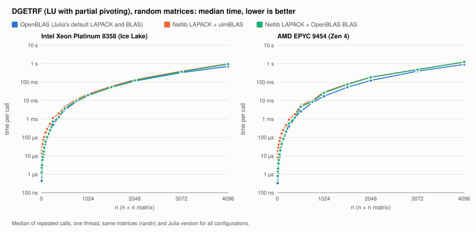

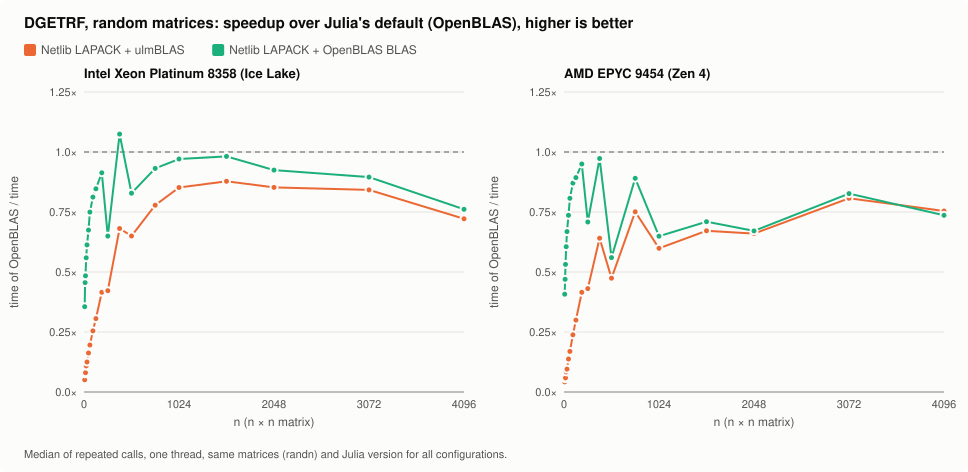

Netlib LAPACK on top of ulmBLAS is slower than Julia's default at every
size: 0.6–0.9× for n ≥ 768 and 0.04–0.3× for n ≤ 128.  For large matrices
the gap comes mostly from the LAPACK algorithm (Netlib LAPACK with
OpenBLAS's BLAS is about as slow); for small matrices it is the cost of the
many tiny BLAS calls of Netlib's recursive panel factorization (about
250 ns more per call in ulmBLAS).  The tests of `DGETRF` (632 checks: INFO,
pivots equal to OpenBLAS, residuals) pass on both machines.

### Matrices diagonally dominant by columns (no row interchanges)

The same benchmark for matrices strictly diagonally dominant by columns
(the same random off-diagonal entries, diagonal ±1.25 × column sum), for
which partial pivoting makes no row interchanges: `IPIV[i] == i` and the
residuals are checked in all three configurations.  `DGETRF` still
searches for the pivots (IDAMAX) and runs DLASWP over the pivot vector, so
this is not an LU without pivoting.  Random and column-dominant matrices
were measured in the same job, taking turns.

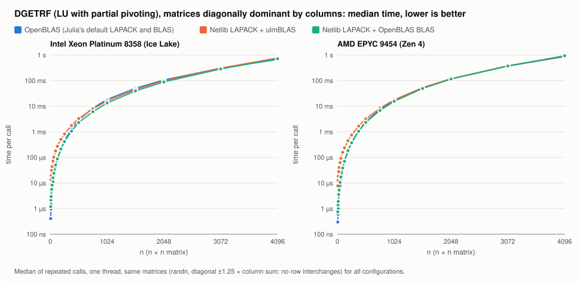

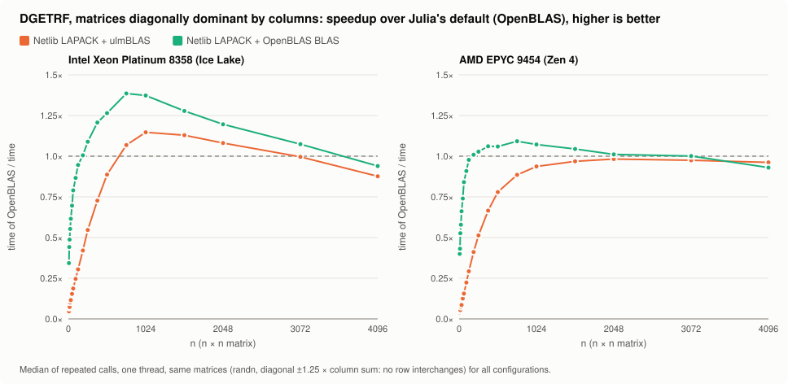

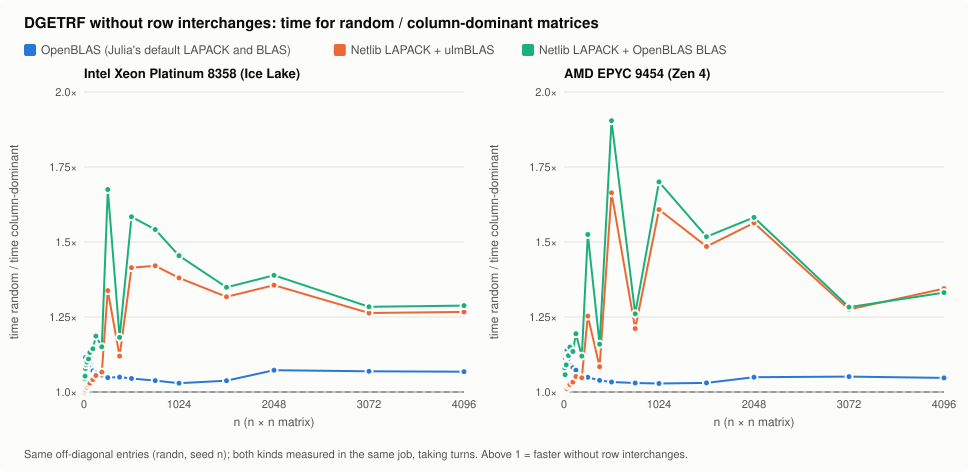

- Without row interchanges, Netlib LAPACK becomes 1.2–1.9× faster for
  n ≥ 512 (1.1–1.7× at 256 and 384; both BLAS); OpenBLAS's own LU only
  3–7%.  The row interchanges
  are done by Netlib's DLASWP (inside liblapack, not OpenBLAS's `dlaswp`,
  in both Netlib configurations).
- For large n this removes most of the gap to OpenBLAS: Netlib LAPACK +
  ulmBLAS reaches 1.07–1.15× of OpenBLAS for n = 768–2048 on Ice Lake
  (0.88× at 4096) and 0.89–0.98× for n ≥ 768 on Zen 4 (random matrices:
  0.72–0.88× and 0.60–0.81×).  Small matrices are unchanged (0.04–0.3×):
  the cost of the tiny BLAS calls remains.
- The drops at n = 256, 512 (and 1024 on Zen 4) disappear: they come from
  Netlib's row interchanges (leading dimension a power of two).
- With the same LAPACK, ulmBLAS against OpenBLAS's BLAS stays about the
  same (Ice Lake 0.84–0.93×, Zen 4 0.87–1.03× for n ≥ 1024).

### Time per BLAS routine: ulmBLAS against OpenBLAS's BLAS

Netlib LAPACK + ulmBLAS against Netlib LAPACK + OpenBLAS's BLAS (the same
LAPACK code, block sizes and DLASWP): every BLAS call of DGETRF timed,
random matrices.  For each routine, the time per DGETRF with OpenBLAS's
BLAS and with ulmBLAS (top, log scale) and the ratio (bottom):

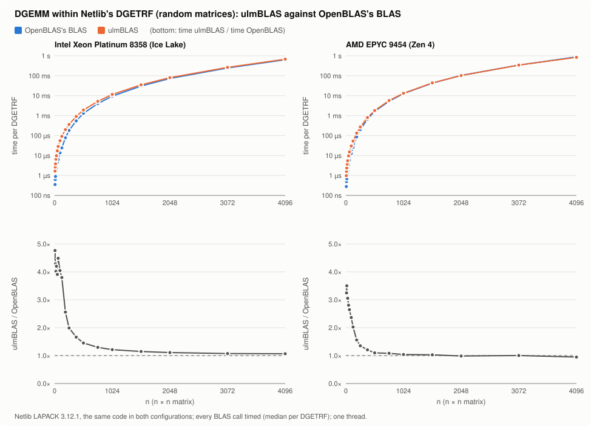

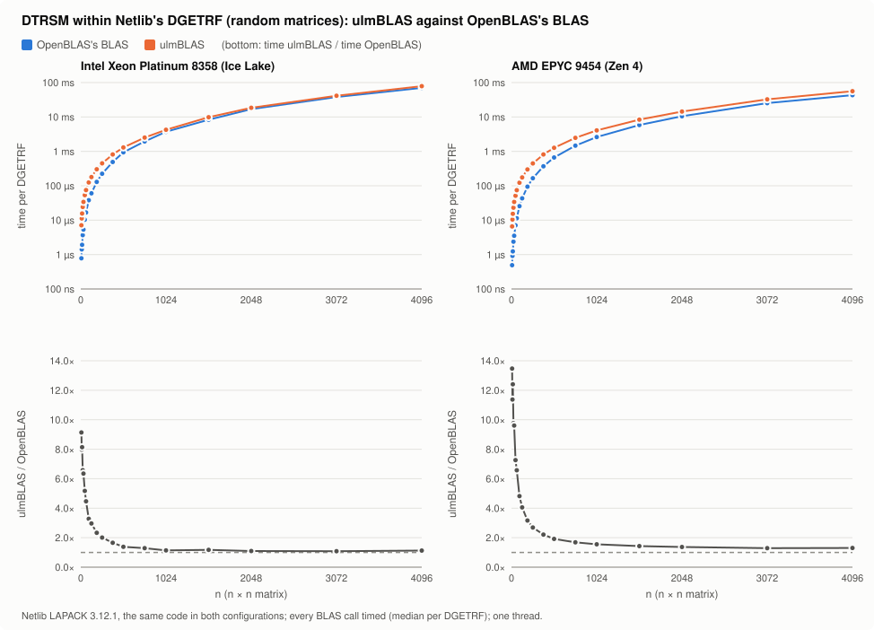

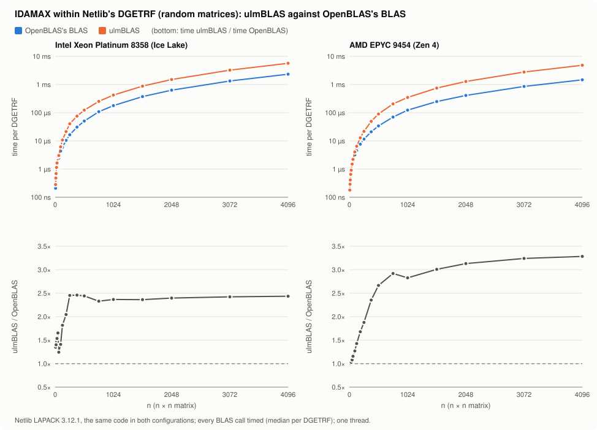

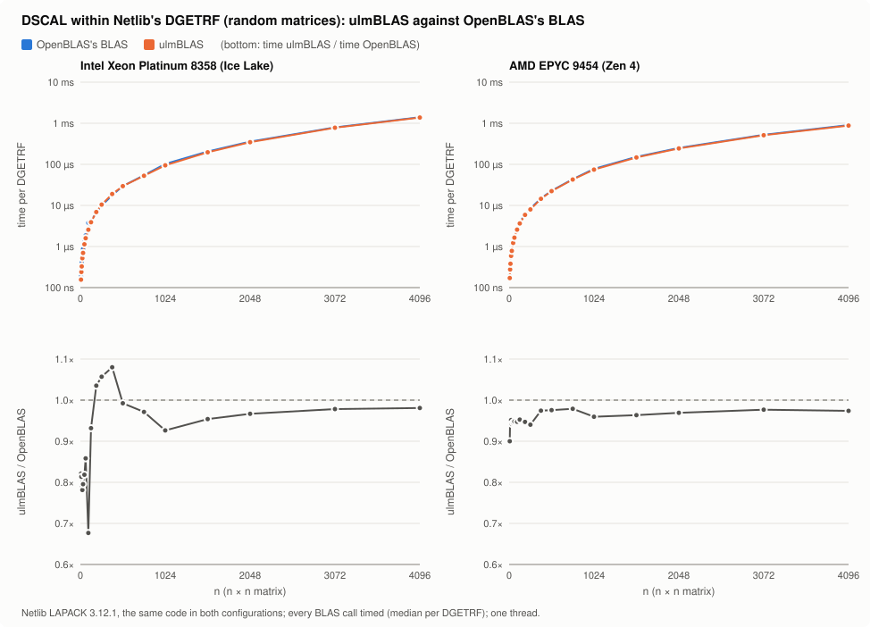

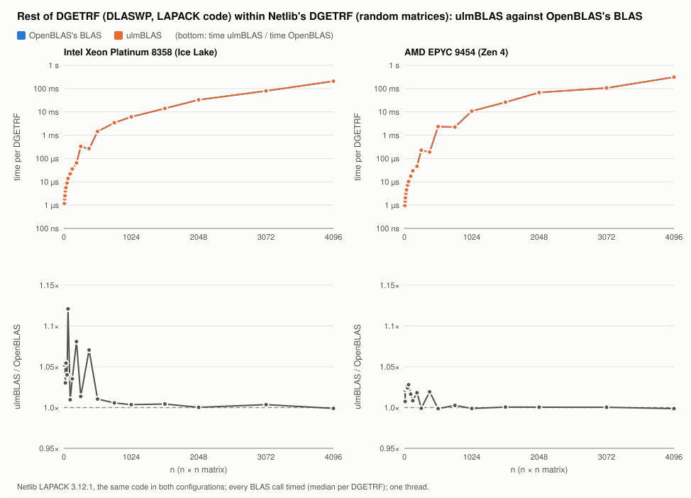

- Small matrices: DTRSM (62–90% of the time lost; about 0.9 µs more per
  tiny call), then DGEMM.
- Large matrices: on Ice Lake DGEMM (ulmBLAS 7–21% slower for n ≥ 1024),
  then DTRSM; on Zen 4 DTRSM (1.3–1.6× slower) and IDAMAX, while
  ulmBLAS's DGEMM is as fast or faster.  IDAMAX is 2.4–3.3× slower on both
  (a small part of the time).  The rest of DGETRF (DLASWP, LAPACK code) is
  the same in both.

### ulmBLAS with OpenBLAS's DTRSM

The same DGETRF benchmark with a fourth configuration: Netlib LAPACK +
ulmBLAS, but DTRSM from OpenBLAS (only the LBT entry of `dtrsm_64_`
changed).  Speedup over Netlib LAPACK + OpenBLAS's BLAS:

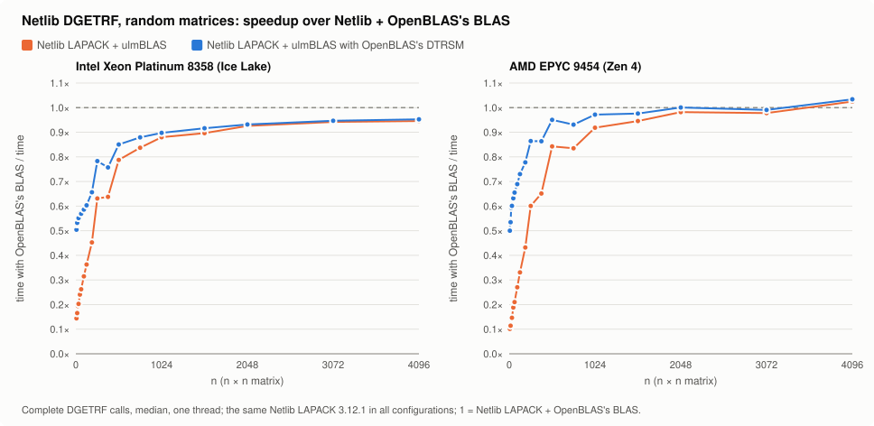

Time of DGETRF (top) and time / time with OpenBLAS's BLAS (bottom):

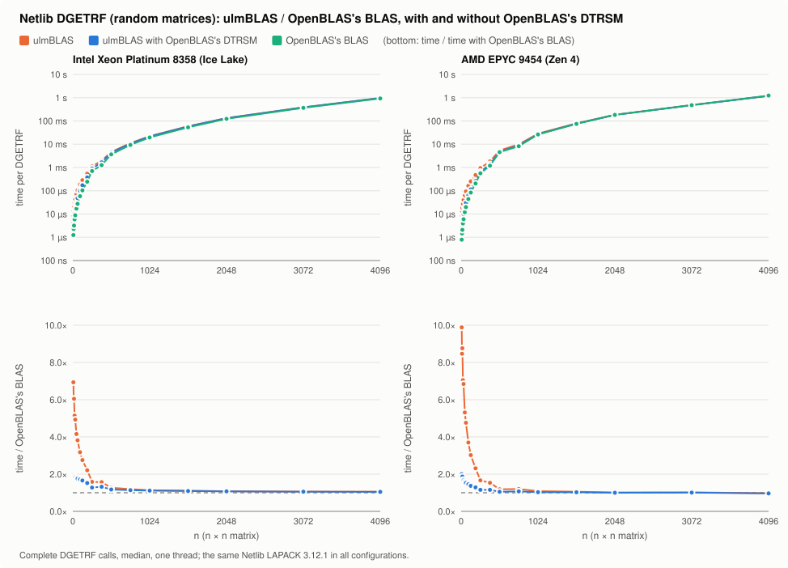

- **Small matrices:** OpenBLAS's DTRSM removes more than half of the gap
  (n = 8: 0.14× → 0.50× on Ice Lake, 0.10× → 0.50× on Zen 4; n = 128:
  0.36× → 0.60× and 0.33× → 0.73×).  The rest, a factor of about 2 for
  n ≤ 64, is in the other tiny BLAS calls, mostly DGEMM (see the time per
  routine).
- **Large matrices:** on Zen 4, with OpenBLAS's DTRSM Netlib + ulmBLAS
  reaches Netlib + OpenBLAS's BLAS for n ≥ 1024 (0.97–1.03×); on Ice Lake
  it changes little for n ≥ 1024 (0.88 → 0.90× at 1024, 0.95× at 4096
  either way): there the gap is ulmBLAS's DGEMM.
- Column-dominant matrices: the same picture (DLASWP is the same code in
  all three configurations).

Details, tables and raw data: [`lapack/README.md`](lapack/README.md).
