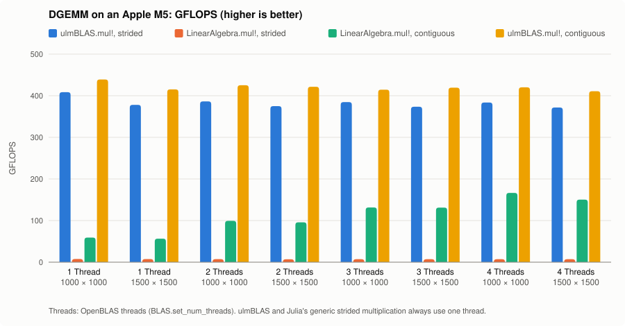
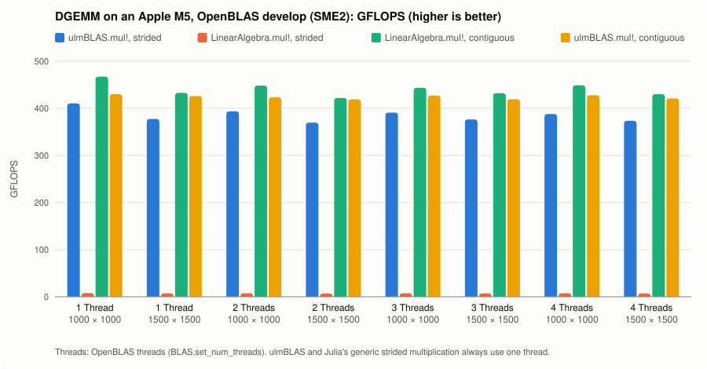

# ulmBLAS.jl

Use the BLAS of [ulmBLAS](https://github.com/michael-lehn/ulmBLAS) in
Julia.  The package does two things:

- `using ulmBLAS` makes ulmBLAS the BLAS of Julia: `A * B`, `BLAS.gemm!`,
  triangular solves etc. then call ulmBLAS.  LAPACK stays with OpenBLAS.
- `ulmBLAS.mul!` computes `C = α A B + β C` for matrices with arbitrary
  strides, e.g. every second row of a matrix, without copies.

```julia
using LinearAlgebra, ulmBLAS

A = rand(500, 300); B = rand(300, 200);
C = A * B;                          # dgemm of ulmBLAS
BLAS.get_config()                   # ulmBLAS for BLAS, OpenBLAS for LAPACK
```

## Installation

The package is not registered, and there are no prebuilt libraries yet.
Build the library with ulmBLAS:

```sh
git clone https://github.com/michael-lehn/ulmBLAS
cd ulmBLAS
make lbt                    # libulmblas_lbt.dylib (macOS) or .so (Linux)
```

and set `ULMBLAS_LIBRARY` before `using ulmBLAS`:

```sh
export ULMBLAS_LIBRARY=$HOME/ulmBLAS/libulmblas_lbt.dylib
julia --project=/path/to/ulmBLAS.jl     # Pkg.instantiate() once
```

In another environment add the package with
`Pkg.develop(path="/path/to/ulmBLAS.jl")`.

Without `ULMBLAS_LIBRARY` the package looks for a prebuilt library for
this CPU.  As there is none yet, it prints a warning and Julia keeps
OpenBLAS.  A library can also be loaded later with
`ulmBLAS.forward("/path/to/libulmblas_lbt.dylib")`.

`make lbt ARCHFLAGS=...` selects the micro kernels, e.g.
`ARCHFLAGS=-mcpu=apple-m4` for SME2 (see [CPU variants](#cpu-variants)).

## ulmBLAS as the BLAS of Julia

After `using ulmBLAS` the BLAS calls of `LinearAlgebra` go to ulmBLAS:

```julia
using LinearAlgebra, ulmBLAS

ulmBLAS.library_path()              # the library in use
A = rand(ComplexF32, 100, 100); B = rand(ComplexF32, 100, 100);
C = similar(A);
mul!(C, A, B);                      # cgemm of ulmBLAS
BLAS.gemm!('C', 'N', one(ComplexF32), A, B, zero(ComplexF32), C);
println(C ≈ A' * B)                 # should print true
```

- LAPACK (`lu`, `qr`, `eigen`, ...) comes from OpenBLAS and uses OpenBLAS's
  BLAS internally.
- Single-threaded: `BLAS.set_num_threads` has no effect on ulmBLAS.

Julia calls BLAS through
[libblastrampoline](https://github.com/JuliaLinearAlgebra/libblastrampoline);
`using ulmBLAS` loads the library of ulmBLAS into it.  Details in
[docs/details.md](docs/details.md).

## GEMM with arbitrary strides: `ulmBLAS.mul!`

`LinearAlgebra.mul!` calls BLAS only if every matrix has row stride 1.
For other views, e.g. `view(P, 1:2:2n, :)`, it falls back to a generic
Julia loop (no BLAS call).  `ulmBLAS.mul!` passes the strides of Julia's
arrays directly to the GEMM of ulmBLAS:

```julia
using LinearAlgebra, ulmBLAS

n = 100
P = rand(2n, n);
A = view(P, 1:2:2n, :);             # every second row: row stride 2
B = rand(n, n);
C = zeros(n, n);

ulmBLAS.mul!(C, A, B);              # C = A B
println(C ≈ A * B)                  # should print true

C0 = rand(n, n); C = copy(C0);
ulmBLAS.mul!(C, A', B, 2.0, -1.0);  # C = 2 A' B - C
println(C ≈ 2 * A' * B - C0)        # should print true

Z = rand(ComplexF64, n, n); W = rand(ComplexF64, 2n, n);
X = view(W, 2n:-2:1, :);            # negative row stride
Y = zeros(ComplexF64, n, n);
ulmBLAS.mul!(Y, transpose(Z), X');  # Y = Zᵀ Xᴴ
println(Y ≈ transpose(Z) * X')      # should print true
```

- Types: `Float32`, `Float64`, `ComplexF32`, `ComplexF64`, the same for
  `A`, `B` and `C`; `α` and `β` are converted.  Other types raise a
  `MethodError` (no fallback).
- `A`, `B`: strided matrices (`Matrix`, views with ranges, also with
  negative or zero steps) and their `transpose` or `adjoint`.  `C`: a
  strided matrix or its `transpose`.
- No copies, no allocations.
- `ulmBLAS.mul!` is not exported and not a method of `LinearAlgebra.mul!`,
  which keeps its own behavior.

**Contract (not checked):** `C` must not overlap with `A` or `B`, and the
elements of `C` must be distinct (no zero stride, except for a dimension
of length 1).  `A` and `B` may overlap.  If `C` might share memory with
`A` or `B`, use `ulmBLAS.mul_aliased!`:

```julia
Q = rand(2n, n); Q0 = copy(Q);
ulmBLAS.mul_aliased!(view(Q, 1:n, :), view(Q, n+1:2n, :), view(Q, 1:2:2n, :));
println(Q[1:n, :] ≈ Q0[n+1:2n, :] * Q0[1:2:2n, :])  # should print true
```

It computes `α A B` into a temporary matrix if `Base.mightalias` reports a
possible overlap, and is `ulmBLAS.mul!` otherwise.

## First test on my MacBook :-)

I wanted to see how ulmBLAS performs on my MacBook Air with an
Apple M5, especially when a matrix is not stored contiguously.

Here is what I tested:

- Two square matrix sizes: 1000 × 1000 and 1500 × 1500.
- **Contiguous matrices:** ordinary Julia matrices.
- **Strided matrices:** a view taking every second row of a larger
  matrix. No data is copied to make the view.
- **ulmBLAS:** always one thread.
- **OpenBLAS:** one, two, three, and four threads.
- **Julia's generic multiplication:** what `LinearAlgebra.mul!` uses
  for this particular strided view.

The smaller the time in milliseconds (`ms`), the faster the
multiplication. `GFLOPS` measures billions of floating-point operations
per second, so **higher is better**.

```julia
# Start Julia in the bench environment (BenchmarkTools), with
# ULMBLAS_LIBRARY set:  julia --project=bench
using LinearAlgebra, Libdl, Printf, Random, BenchmarkTools, ulmBLAS
import OpenBLAS_jll

# `using ulmBLAS` routes Julia's BLAS calls to ulmBLAS.  Switch them back to
# OpenBLAS, so that LinearAlgebra.mul! measures OpenBLAS.
oblib  = OpenBLAS_jll.libopenblas_path
ulmlib = ulmBLAS.library_path()
BLAS.lbt_forward(oblib; clear=true, suffix_hint="64_")

# Check: Julia's dgemm is the one of OpenBLAS ...
addr(lib, f) = UInt(dlsym(dlopen(lib), f))
@assert UInt(BLAS.lbt_get_forward("dgemm_", :ilp64)) == addr(oblib, "dgemm_64_")
# ... and ulmBLAS.mul! calls ulmblas_dgemm_strided of ulmBLAS.
@assert UInt(ulmBLAS.gemm_strided_ptr[Float64]) ==
        addr(ulmlib, "ulmblas_dgemm_strided")

# Check: count the dgemm calls of LinearAlgebra.mul! (the strided view
# gets none: Julia uses its generic loop instead of BLAS).
realgemm = BLAS.lbt_get_forward("dgemm_", :ilp64)
ncalls = Ref(0)
function countgemm(ta::Ptr{UInt8}, tb::Ptr{UInt8}, m::Ptr{Int64},
                   n::Ptr{Int64}, k::Ptr{Int64}, al::Ptr{Float64},
                   A::Ptr{Float64}, lda::Ptr{Int64}, B::Ptr{Float64},
                   ldb::Ptr{Int64}, be::Ptr{Float64}, C::Ptr{Float64},
                   ldc::Ptr{Int64}, l1::Csize_t, l2::Csize_t)
    ncalls[] += 1
    ccall(realgemm, Cvoid,
          (Ptr{UInt8}, Ptr{UInt8}, Ptr{Int64}, Ptr{Int64}, Ptr{Int64},
           Ptr{Float64}, Ptr{Float64}, Ptr{Int64}, Ptr{Float64}, Ptr{Int64},
           Ptr{Float64}, Ptr{Float64}, Ptr{Int64}, Csize_t, Csize_t),
          ta, tb, m, n, k, al, A, lda, B, ldb, be, C, ldc, l1, l2)
end
cf = @cfunction(countgemm, Cvoid,
                (Ptr{UInt8}, Ptr{UInt8}, Ptr{Int64}, Ptr{Int64}, Ptr{Int64},
                 Ptr{Float64}, Ptr{Float64}, Ptr{Int64}, Ptr{Float64},
                 Ptr{Int64}, Ptr{Float64}, Ptr{Float64}, Ptr{Int64}, Csize_t,
                 Csize_t))
let P = rand(64, 32), A = view(P, 1:2:64, :), B = rand(32, 32),
    C = zeros(32, 32)
    BLAS.lbt_set_forward("dgemm_", cf, :ilp64)
    ncalls[] = 0; LinearAlgebra.mul!(C, A, B);          s = ncalls[]
    ncalls[] = 0; LinearAlgebra.mul!(C, Matrix(A), B);  c = ncalls[]
    BLAS.lbt_set_forward("dgemm_", realgemm, :ilp64)
    @assert s == 0 && c == 1
end

oblas_threads() = ccall((:openblas_get_num_threads64_, oblib), Cint, ())
gflops(n, t) = 2.0*n^3/t

for threads in 1:4
    BLAS.set_num_threads(threads)            # affects OpenBLAS only
    @assert oblas_threads() == threads
    for n in (1000, 1500)
        Random.seed!(n)
        P  = rand(2n, n)
        A  = view(P, 1:2:2n, :)              # every second row: stride 2
        Ac = Matrix(A)                       # the same matrix, contiguous
        B  = rand(n, n)
        C  = zeros(n, n)
        R  = Ac * B                          # OpenBLAS
        for (name, X, ulm) in (("ulmBLAS.mul!, strided",          A,  true),
                               ("LinearAlgebra.mul!, strided",    A,  false),
                               ("LinearAlgebra.mul!, contiguous", Ac, false),
                               ("ulmBLAS.mul!, contiguous",       Ac, true))
            ulm ? ulmBLAS.mul!(C, X, B) : LinearAlgebra.mul!(C, X, B)
            @assert C ≈ R
            b = ulm ? @benchmark(ulmBLAS.mul!($C, $X, $B)) :
                      @benchmark(LinearAlgebra.mul!($C, $X, $B))
            t = minimum(b).time
            th = !ulm && X === Ac ? threads : 1
            @printf("%-31s %-5d threads %d %8.1f ms %7.1f GFLOPS %3d bytes %d allocs\n",
                    name, n, th, t/1e6, gflops(n, t), b.memory, b.allocs)
        end
    end
end
```

**To reproduce the benchmark**, run the Julia example above (start
Julia with `--project=bench` and set `ULMBLAS_LIBRARY` as described
under [Installation](#installation)). It is self-contained: it switches
Julia's BLAS calls back to OpenBLAS after `using ulmBLAS`, checks which
implementation is called, verifies the results, and measures execution
time and allocations.

You can also run the [full benchmark script](bench/gemm_threads.jl),
which records the measurements in a TSV file. The output below is from
the original M5 run; individual timings will vary slightly between runs.

Here is the actual output from my M5. The times are the fastest
measurements reported by BenchmarkTools:

```text
library of ulmBLAS: /Users/lehn/git/ulmBLAS.jl/dev/lib/libulmblas_lbt.dylib
LBT after `using ulmBLAS`: dgemm_ -> ulmBLAS
LBT for this benchmark:   dgemm_ -> OpenBLAS (libopenblas64_.0.3.30.dylib)
ulmBLAS.mul!:             ulmblas_dgemm_strided of libulmblas_lbt.dylib
dgemm_ calls through LBT: LinearAlgebra.mul! strided 0, contiguous 1; ulmBLAS.mul! 0
CPU: Apple M5 (4 performance + 6 efficiency cores), Julia 1.13.3, Julia threads 1, OpenBLAS libopenblas64_.0.3.30.dylib

case                            n     backend                   threads      ms    GFLOPS   bytes allocs
ulmBLAS.mul!, strided           1000  ulmBLAS (1 thread)              1     4.9     408.5       0      0
LinearAlgebra.mul!, strided     1000  generic Julia (1 thread)        1   262.5       7.6      64      1
LinearAlgebra.mul!, contiguous  1000  OpenBLAS                        1    33.8      59.2       0      0
ulmBLAS.mul!, contiguous        1000  ulmBLAS (1 thread)              1     4.6     438.9       0      0
ulmBLAS.mul!, strided           1500  ulmBLAS (1 thread)              1    17.9     378.1       0      0
LinearAlgebra.mul!, strided     1500  generic Julia (1 thread)        1   905.7       7.5      64      1
LinearAlgebra.mul!, contiguous  1500  OpenBLAS                        1   119.6      56.5       0      0
ulmBLAS.mul!, contiguous        1500  ulmBLAS (1 thread)              1    16.3     415.1       0      0
ulmBLAS.mul!, strided           1000  ulmBLAS (1 thread)              1     5.2     386.4       0      0
LinearAlgebra.mul!, strided     1000  generic Julia (1 thread)        1   270.0       7.4      64      1
LinearAlgebra.mul!, contiguous  1000  OpenBLAS                        2    20.1      99.3       0      0
ulmBLAS.mul!, contiguous        1000  ulmBLAS (1 thread)              1     4.7     425.1       0      0
ulmBLAS.mul!, strided           1500  ulmBLAS (1 thread)              1    18.0     374.9       0      0
LinearAlgebra.mul!, strided     1500  generic Julia (1 thread)        1   954.1       7.1      64      1
LinearAlgebra.mul!, contiguous  1500  OpenBLAS                        2    70.4      95.9       0      0
ulmBLAS.mul!, contiguous        1500  ulmBLAS (1 thread)              1    16.0     421.5       0      0
ulmBLAS.mul!, strided           1000  ulmBLAS (1 thread)              1     5.2     384.7       0      0
LinearAlgebra.mul!, strided     1000  generic Julia (1 thread)        1   276.5       7.2      64      1
LinearAlgebra.mul!, contiguous  1000  OpenBLAS                        3    15.2     131.6       0      0
ulmBLAS.mul!, contiguous        1000  ulmBLAS (1 thread)              1     4.8     414.5       0      0
ulmBLAS.mul!, strided           1500  ulmBLAS (1 thread)              1    18.1     373.5       0      0
LinearAlgebra.mul!, strided     1500  generic Julia (1 thread)        1   931.1       7.2      64      1
LinearAlgebra.mul!, contiguous  1500  OpenBLAS                        3    51.5     131.1       0      0
ulmBLAS.mul!, contiguous        1500  ulmBLAS (1 thread)              1    16.1     419.4       0      0
ulmBLAS.mul!, strided           1000  ulmBLAS (1 thread)              1     5.2     383.7       0      0
LinearAlgebra.mul!, strided     1000  generic Julia (1 thread)        1   277.7       7.2      64      1
LinearAlgebra.mul!, contiguous  1000  OpenBLAS                        4    12.0     166.6       0      0
ulmBLAS.mul!, contiguous        1000  ulmBLAS (1 thread)              1     4.8     420.1       0      0
ulmBLAS.mul!, strided           1500  ulmBLAS (1 thread)              1    18.2     371.7       0      0
LinearAlgebra.mul!, strided     1500  generic Julia (1 thread)        1   939.4       7.2      64      1
LinearAlgebra.mul!, contiguous  1500  OpenBLAS                        4    44.9     150.4       0      0
ulmBLAS.mul!, contiguous        1500  ulmBLAS (1 thread)              1    16.4     410.8       0      0
```

This long output says it all:



### Some notes on that

- **The strided view matters.** Julia's usual `LinearAlgebra.mul!`
  takes about 906 ms for the 1500 × 1500 view. `ulmBLAS.mul!` takes
  about 18 ms for the same operation — roughly **50 times faster**.
- **Strides cost relatively little in ulmBLAS.** At size 1500,
  the strided multiplication takes about 18 ms, compared with about
  16 ms for a contiguous matrix. No contiguous copy of the input
  matrix is needed.
- **More OpenBLAS threads help.** For a contiguous 1500 × 1500
  matrix, OpenBLAS goes from about 120 ms with one thread to
  45 ms with four.
- **ulmBLAS is still faster in this test.** Its single-threaded
  contiguous multiplication takes about 16 ms.
- **No extra allocations in ulmBLAS.** The `bytes` and `allocs`
  columns are both zero for its operations.

The output is arranged in four groups, one for each OpenBLAS thread
setting. Only OpenBLAS uses the extra threads. ulmBLAS and Julia's
generic strided multiplication remain single-threaded.

### One important caveat

This does **not** mean ulmBLAS is always faster than OpenBLAS.
My ulmBLAS build uses the Apple M5's **SME2 matrix instructions**,
while the OpenBLAS 0.3.30 shipped with this Julia installation uses
older **NEON instructions** on this machine. So this is also a
comparison of different CPU instruction sets, not just two libraries.

I'd like to repeat the test with a newer OpenBLAS and with Apple's
Accelerate library.

## Second test on my MacBook :-(

Well, that changes the picture. :-) This time I repeated the benchmark
with a recent development version of OpenBLAS (`develop`, commit `9d78ff857`,
`v0.3.34-641`), built from source. Unlike Julia's bundled OpenBLAS, this
version has SME2 kernels for DGEMM. And it really uses them on my M5:
OpenBLAS detects the `vortexm4` core, and breakpoints confirmed that
`dgemm_` reaches `sme_dgemm_kernel_VORTEXM4`, not a NEON kernel. The
[build record](bench/results/2026-10-31-apple-m5-openblas-dev-build.txt)
contains the compiler, build command, and kernel checks.

I used the [same benchmark script](bench/gemm_threads.jl) as before,
this time pointing it at the locally built OpenBLAS:

```sh
cd bench
OPENBLAS_LIBRARY=/path/to/libopenblas.dylib OPENBLAS_SUFFIX= \
    ULMBLAS_LIBRARY=/path/to/libulmblas_lbt.dylib julia --project=. gemm_threads.jl
```

(`OPENBLAS_SUFFIX=` because this build has no `64_` suffix on its symbol
names.)

Here is the output from a run on my M5 with the machine otherwise quiet:

```text
library of ulmBLAS: /Users/lehn/git/ulmBLAS.jl/dev/lib/libulmblas_lbt.dylib
LBT after `using ulmBLAS`: dgemm_ -> ulmBLAS
LBT for this benchmark:   dgemm_ -> OpenBLAS (libopenblas.dylib)
ulmBLAS.mul!:             ulmblas_dgemm_strided of libulmblas_lbt.dylib
dgemm_ calls through LBT: LinearAlgebra.mul! strided 0, contiguous 1; ulmBLAS.mul! 0
CPU: Apple M5 (4 performance + 6 efficiency cores), Julia 1.13.3, Julia threads 1, OpenBLAS libopenblas.dylib
OpenBLAS: OpenBLAS 0.3.34.dev  USE64BITINT DYNAMIC_ARCH NO_AFFINITY vortexm4 MAX_THREADS=64; core: vortexm4

case                            n     backend                   threads      ms    GFLOPS   bytes allocs
ulmBLAS.mul!, strided           1000  ulmBLAS (1 thread)              1     4.9     410.6       0      0
LinearAlgebra.mul!, strided     1000  generic Julia (1 thread)        1   253.9       7.9      64      1
LinearAlgebra.mul!, contiguous  1000  OpenBLAS                        1     4.3     467.3       0      0
ulmBLAS.mul!, contiguous        1000  ulmBLAS (1 thread)              1     4.6     430.2       0      0
ulmBLAS.mul!, strided           1500  ulmBLAS (1 thread)              1    17.9     377.5       0      0
LinearAlgebra.mul!, strided     1500  generic Julia (1 thread)        1   927.7       7.3      64      1
LinearAlgebra.mul!, contiguous  1500  OpenBLAS                        1    15.6     432.8       0      0
ulmBLAS.mul!, contiguous        1500  ulmBLAS (1 thread)              1    15.8     426.2       0      0
ulmBLAS.mul!, strided           1000  ulmBLAS (1 thread)              1     5.1     393.7       0      0
LinearAlgebra.mul!, strided     1000  generic Julia (1 thread)        1   269.0       7.4      64      1
LinearAlgebra.mul!, contiguous  1000  OpenBLAS                        2     4.5     448.3       0      0
ulmBLAS.mul!, contiguous        1000  ulmBLAS (1 thread)              1     4.7     423.6       0      0
ulmBLAS.mul!, strided           1500  ulmBLAS (1 thread)              1    18.3     369.7       0      0
LinearAlgebra.mul!, strided     1500  generic Julia (1 thread)        1   964.3       7.0      64      1
LinearAlgebra.mul!, contiguous  1500  OpenBLAS                        2    16.0     422.0       0      0
ulmBLAS.mul!, contiguous        1500  ulmBLAS (1 thread)              1    16.1     419.1       0      0
ulmBLAS.mul!, strided           1000  ulmBLAS (1 thread)              1     5.1     391.0       0      0
LinearAlgebra.mul!, strided     1000  generic Julia (1 thread)        1   265.0       7.5      64      1
LinearAlgebra.mul!, contiguous  1000  OpenBLAS                        3     4.5     443.7       0      0
ulmBLAS.mul!, contiguous        1000  ulmBLAS (1 thread)              1     4.7     427.2       0      0
ulmBLAS.mul!, strided           1500  ulmBLAS (1 thread)              1    17.9     376.6       0      0
LinearAlgebra.mul!, strided     1500  generic Julia (1 thread)        1   935.3       7.2      64      1
LinearAlgebra.mul!, contiguous  1500  OpenBLAS                        3    15.6     432.1       0      0
ulmBLAS.mul!, contiguous        1500  ulmBLAS (1 thread)              1    16.1     419.4       0      0
ulmBLAS.mul!, strided           1000  ulmBLAS (1 thread)              1     5.2     388.1       0      0
LinearAlgebra.mul!, strided     1000  generic Julia (1 thread)        1   263.1       7.6      64      1
LinearAlgebra.mul!, contiguous  1000  OpenBLAS                        4     4.5     449.0       0      0
ulmBLAS.mul!, contiguous        1000  ulmBLAS (1 thread)              1     4.7     427.8       0      0
ulmBLAS.mul!, strided           1500  ulmBLAS (1 thread)              1    18.1     373.4       0      0
LinearAlgebra.mul!, strided     1500  generic Julia (1 thread)        1   941.9       7.2      64      1
LinearAlgebra.mul!, contiguous  1500  OpenBLAS                        4    15.7     430.2       0      0
ulmBLAS.mul!, contiguous        1500  ulmBLAS (1 thread)              1    16.0     421.0       0      0
```



### Some notes on that

- **Now we're talking.** With SME2 on both sides, OpenBLAS reaches
  430–467 GFLOPS for contiguous matrices, versus 419–430 GFLOPS for
  ulmBLAS. At n = 1000, OpenBLAS is about 9% faster with one thread;
  at n = 1500, they're within 3%. My big lead from the first test is gone. :-)
- **But where are the other threads?** Changing OpenBLAS's thread setting
  from 1 to 4 barely changes the results. The complete run used about
  one CPU core (346 seconds of CPU time over 345 seconds of wall time),
  and the SME2 kernel was entered once per call, even with four threads
  requested. So the `threads` column records the *requested setting*,
  not the number of cores actually doing work. This observation applies
  to this build and these measurements; it isn't a general claim about
  all OpenBLAS kernels.
- **Arbitrary strides still matter.** `LinearAlgebra.mul!` makes no
  BLAS `dgemm_` call for the strided view, regardless of which OpenBLAS
  is selected. `ulmBLAS.mul!` continues to use its strided GEMM directly.

## Further Ideas

The current interface already supports matrices with arbitrary row and column
strides. But why stop at matrices whose elements are stored in memory?

One possible next step is to implement the **GEMM frame algorithm in Julia**,
while continuing to use ulmBLAS's optimized micro-kernels. Packing would be
the natural boundary: Julia could read elements from more general matrix
objects, convert them to a supported computation type, and pack them into
the buffers expected by the existing kernels.

Some possibilities worth exploring:

- **Mixed element types.** Allow `A`, `B`, and `C` to have different
  element types. Start with supported floating-point and complex types,
  selecting an appropriate computation type for the packed panels. A
  different type for `C` may require a temporary output tile and explicit
  conversion on write-back. Integer inputs could eventually be converted
  during packing, but that would *not* be integer GEMM or provide integer
  micro-kernels.
- **Matrices computed on demand.** Accept read-only matrix objects that
  implement indexed element access, even when no dense backing storage
  exists. For example, a transposed or scaled matrix expression could be
  evaluated as its elements are packed, without materializing the entire
  intermediate matrix.
- **More general matrix expressions.** Explore products involving sums,
  transposes, and scaled operands. This would need careful treatment of
  repeated evaluation, aliasing, type promotion, and the cost of computing
  each element; it would not automatically make every lazy expression fast.
- **Performance experiments.** Compare Julia-level packing and frame-loop
  overhead against the current native implementation, especially for small
  matrices and expensive element access. Preserve the existing fast path
  for ordinary strided arrays.

These are ideas for future experiments, **not implemented features or an
immediate development plan**. I explored related approaches years ago in
[C++/uBLAS](https://www.mathematik.uni-ulm.de/~lehn/test_ublas/) and
[Blaze](https://www.mathematik.uni-ulm.de/~lehn/test_blaze/session1/page01.html).
The Blaze example in particular evaluates expressions such as
`trans(A) + A` and `2 * B` while packing, rather than first constructing
full temporary matrices.

## CPU variants

ulmBLAS selects its micro kernels at compile time.  The package is meant
to contain one library per kind of CPU and to load the one for the CPU it
runs on (`ulmBLAS.variant()`):

| Variant | CPU | Micro kernels (S, D, C, Z) |
|---|---|---|
| `sme` | Apple M4 and later | ulmBLAS SME2 |
| `neon` | Apple M1 to M3 | ulmBLAS NEON |
| `zen4` | AMD with AVX-512 (Zen 4, Zen 5) | OpenBLAS SKYLAKEX (S, C), AOCL zen4 (D, Z) |
| `skylakex` | Intel with AVX-512 | OpenBLAS SKYLAKEX (S, D, C), AOCL zen4 (Z) |
| `haswell` | AVX2 and FMA | OpenBLAS HASWELL |
| `x86_64` | other x86-64 | ulmBLAS SSE (D), reference kernels |

Platforms: macOS on Apple silicon, Linux on x86-64 (glibc).  The choice
follows the
[benchmark campaigns](https://github.com/michael-lehn/ulmBLAS/tree/master/benchmark_results)
of ulmBLAS; the flags of each variant are in
[docs/details.md](docs/details.md#kernel-selection).

## Building the libraries (maintainers)

```sh
build/build.sh ~/ulmBLAS out-mac        # all variants of this platform
julia build/artifacts.jl 0.1.0 out-mac=aarch64-apple-darwin \
                               out-linux=x86_64-linux-gnu
```

- `build/build.sh SRC OUT [VARIANT ...]` builds
  `OUT/lib/VARIANT/libulmblas_lbt.*` from the ulmBLAS sources in `SRC`,
  with the license and a record of the build (commit, compiler, flags).
- `build/artifacts.jl` packs these directories into `dist/` and writes
  `Artifacts.toml`; the tarballs belong to the release `vVERSION` of this
  repository.

## Tests

```julia
using Pkg; Pkg.test("ulmBLAS")
```

With `ULMBLAS_TEST_LINALG=1` the BLAS and matrix product tests of
`LinearAlgebra` are run with ulmBLAS as well (several minutes).

## License

BSD 3-Clause, like ulmBLAS.  The libraries contain micro kernels of BLIS,
AOCL-BLAS and OpenBLAS; their licenses are part of every artifact
(`share/licenses/ulmBLAS/LICENSE`).
