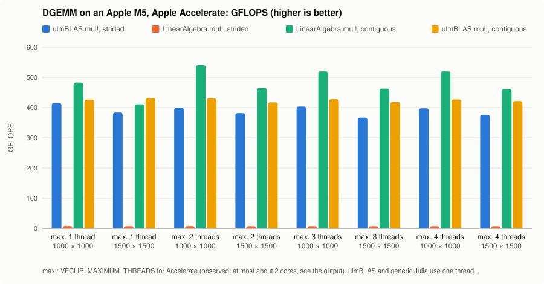

# Third Benchmark on my MacBook: Accelerate

> Recorded before the package was renamed from `ulmBLAS.jl` to `UlmBLAS.jl`:
> in the recorded output and the chart, `ulmBLAS.mul!` is today's
> `UlmBLAS.mul!`.  ulmBLAS (the C/C++ library) keeps its name.

The same benchmark as the [first](benchmark_001.md) and
[second](benchmark_002.md) one, with Apple's Accelerate instead of
OpenBLAS behind `LinearAlgebra.mul!`: Accelerate 1.11 (vecLib 3.11) of
macOS 26.6 (25G72) on the Apple M5.  Whether Accelerate uses the SME2
matrix unit internally was not examined; only its public interface is
used.

## How Accelerate is used and checked

- Julia reaches Accelerate through libblastrampoline (LBT), with its ILP64
  interface (symbols such as `dgemm$NEWLAPACK$ILP64`, macOS 13.3 and
  later).  These symbols have no underscore before the suffix; the suffix
  hint `"\x1a$NEWLAPACK$ILP64"` tells LBT to drop it (as
  [AppleAccelerate.jl](https://github.com/JuliaLinearAlgebra/AppleAccelerate.jl)
  does).  With the plain hint `"$NEWLAPACK$ILP64"` LBT silently loads only
  the 32-bit interface, and Julia's 64-bit BLAS calls find no library.
- Before measuring, the script checks that LBT forwards `dgemm_` to
  `dgemm$NEWLAPACK$ILP64` of Accelerate, counts the `dgemm_` calls of
  `LinearAlgebra.mul!` (strided view: none, contiguous: one), checks that
  `UlmBLAS.mul!` calls `ulmblas_dgemm_strided` of ulmBLAS, and compares
  all results with Julia's generic multiplication.

## Threads

Accelerate cannot be given a number of threads the way OpenBLAS can:

- `BLAS.set_num_threads` has no effect on Accelerate
  (`BLAS.get_num_threads()` stays 1).
- `BLASSetThreading` (macOS 15 and later) selects either single-threaded
  or multi-threaded mode, where Accelerate decides how many threads to use.
- The environment variable `VECLIB_MAXIMUM_THREADS` limits the threads
  (man page `Accelerate(7)`); it is read when Accelerate is loaded.

So the benchmark runs one Julia process per setting
`VECLIB_MAXIMUM_THREADS = 1, 2, 3, 4`, each with
`BLASSetThreading(MULTI_THREADED)`.  This is a requested *maximum*, not a
thread count.  For every case the script also measures the parallelism
that actually happened, as process CPU time divided by wall time
(`CPU/wall`).  The chart labels the groups with the requested maximum.

## Reproduce

```sh
cd bench
ULMBLAS_LIBRARY=/path/to/libulmblas_lbt.dylib ./run_accelerate.sh
```

[`run_accelerate.sh`](../bench/run_accelerate.sh) runs
[`gemm_accelerate.jl`](../bench/gemm_accelerate.jl) once per setting
(`julia` must be on the `PATH`).

## Output on my M5

```text
library of ulmBLAS: /Users/lehn/git/ulmBLAS.jl/dev/lib/libulmblas_lbt.dylib
LBT after `using ulmBLAS`: dgemm_ -> ulmBLAS
LBT for this benchmark:   dgemm_ -> Accelerate (dgemm$NEWLAPACK$ILP64, ILP64)
ulmBLAS.mul!:             ulmblas_dgemm_strided of libulmblas_lbt.dylib
dgemm_ calls through LBT: LinearAlgebra.mul! strided 0, contiguous 1; ulmBLAS.mul! 0
Accelerate threading:     BLASSetThreading(MULTI_THREADED), VECLIB_MAXIMUM_THREADS=1, BLAS.get_num_threads() = 1
CPU: Apple M5 (4 performance + 6 efficiency cores), macOS 26.6 (25G72), Julia 1.13.3, Julia threads 1

case                            n     backend                  requested      ms    GFLOPS CPU/wall  bytes allocs
ulmBLAS.mul!, strided           1000  ulmBLAS (1 thread)               -     4.8     415.1     1.00      0      0
LinearAlgebra.mul!, strided     1000  generic Julia (1 thread)         -   254.8       7.8     1.00     64      1
LinearAlgebra.mul!, contiguous  1000  Accelerate                       1     4.1     482.6     1.00      0      0
ulmBLAS.mul!, contiguous        1000  ulmBLAS (1 thread)               -     4.7     426.5     1.00      0      0
ulmBLAS.mul!, strided           1500  ulmBLAS (1 thread)               -    17.6     383.6     0.99      0      0
LinearAlgebra.mul!, strided     1500  generic Julia (1 thread)         -   924.6       7.3     1.00     64      1
LinearAlgebra.mul!, contiguous  1500  Accelerate                       1    16.4     410.9     1.00      0      0
ulmBLAS.mul!, contiguous        1500  ulmBLAS (1 thread)               -    15.7     431.1     1.00      0      0
library of ulmBLAS: /Users/lehn/git/ulmBLAS.jl/dev/lib/libulmblas_lbt.dylib
LBT after `using ulmBLAS`: dgemm_ -> ulmBLAS
LBT for this benchmark:   dgemm_ -> Accelerate (dgemm$NEWLAPACK$ILP64, ILP64)
ulmBLAS.mul!:             ulmblas_dgemm_strided of libulmblas_lbt.dylib
dgemm_ calls through LBT: LinearAlgebra.mul! strided 0, contiguous 1; ulmBLAS.mul! 0
Accelerate threading:     BLASSetThreading(MULTI_THREADED), VECLIB_MAXIMUM_THREADS=2, BLAS.get_num_threads() = 1
CPU: Apple M5 (4 performance + 6 efficiency cores), macOS 26.6 (25G72), Julia 1.13.3, Julia threads 1

case                            n     backend                  requested      ms    GFLOPS CPU/wall  bytes allocs
ulmBLAS.mul!, strided           1000  ulmBLAS (1 thread)               -     5.0     399.3     1.00      0      0
LinearAlgebra.mul!, strided     1000  generic Julia (1 thread)         -   261.0       7.7     1.00     64      1
LinearAlgebra.mul!, contiguous  1000  Accelerate                       2     3.7     540.0     1.93      0      0
ulmBLAS.mul!, contiguous        1000  ulmBLAS (1 thread)               -     4.6     430.6     1.00      0      0
ulmBLAS.mul!, strided           1500  ulmBLAS (1 thread)               -    17.7     381.6     1.00      0      0
LinearAlgebra.mul!, strided     1500  generic Julia (1 thread)         -   921.5       7.3     1.00     64      1
LinearAlgebra.mul!, contiguous  1500  Accelerate                       2    14.5     464.8     1.81      0      0
ulmBLAS.mul!, contiguous        1500  ulmBLAS (1 thread)               -    16.2     417.5     1.00      0      0
library of ulmBLAS: /Users/lehn/git/ulmBLAS.jl/dev/lib/libulmblas_lbt.dylib
LBT after `using ulmBLAS`: dgemm_ -> ulmBLAS
LBT for this benchmark:   dgemm_ -> Accelerate (dgemm$NEWLAPACK$ILP64, ILP64)
ulmBLAS.mul!:             ulmblas_dgemm_strided of libulmblas_lbt.dylib
dgemm_ calls through LBT: LinearAlgebra.mul! strided 0, contiguous 1; ulmBLAS.mul! 0
Accelerate threading:     BLASSetThreading(MULTI_THREADED), VECLIB_MAXIMUM_THREADS=3, BLAS.get_num_threads() = 1
CPU: Apple M5 (4 performance + 6 efficiency cores), macOS 26.6 (25G72), Julia 1.13.3, Julia threads 1

case                            n     backend                  requested      ms    GFLOPS CPU/wall  bytes allocs
ulmBLAS.mul!, strided           1000  ulmBLAS (1 thread)               -     5.0     403.3     1.00      0      0
LinearAlgebra.mul!, strided     1000  generic Julia (1 thread)         -   271.8       7.4     1.00     64      1
LinearAlgebra.mul!, contiguous  1000  Accelerate                       3     3.8     519.8     1.91      0      0
ulmBLAS.mul!, contiguous        1000  ulmBLAS (1 thread)               -     4.7     427.9     1.00      0      0
ulmBLAS.mul!, strided           1500  ulmBLAS (1 thread)               -    18.4     366.6     1.00      0      0
LinearAlgebra.mul!, strided     1500  generic Julia (1 thread)         -   935.9       7.2     1.00     64      1
LinearAlgebra.mul!, contiguous  1500  Accelerate                       3    14.6     462.7     1.82      0      0
ulmBLAS.mul!, contiguous        1500  ulmBLAS (1 thread)               -    16.1     418.5     1.00      0      0
library of ulmBLAS: /Users/lehn/git/ulmBLAS.jl/dev/lib/libulmblas_lbt.dylib
LBT after `using ulmBLAS`: dgemm_ -> ulmBLAS
LBT for this benchmark:   dgemm_ -> Accelerate (dgemm$NEWLAPACK$ILP64, ILP64)
ulmBLAS.mul!:             ulmblas_dgemm_strided of libulmblas_lbt.dylib
dgemm_ calls through LBT: LinearAlgebra.mul! strided 0, contiguous 1; ulmBLAS.mul! 0
Accelerate threading:     BLASSetThreading(MULTI_THREADED), VECLIB_MAXIMUM_THREADS=4, BLAS.get_num_threads() = 1
CPU: Apple M5 (4 performance + 6 efficiency cores), macOS 26.6 (25G72), Julia 1.13.3, Julia threads 1

case                            n     backend                  requested      ms    GFLOPS CPU/wall  bytes allocs
ulmBLAS.mul!, strided           1000  ulmBLAS (1 thread)               -     5.0     397.7     1.00      0      0
LinearAlgebra.mul!, strided     1000  generic Julia (1 thread)         -   267.5       7.5     1.00     64      1
LinearAlgebra.mul!, contiguous  1000  Accelerate                       4     3.8     519.8     1.90      0      0
ulmBLAS.mul!, contiguous        1000  ulmBLAS (1 thread)               -     4.7     427.1     1.00      0      0
ulmBLAS.mul!, strided           1500  ulmBLAS (1 thread)               -    18.0     375.9     1.00      0      0
LinearAlgebra.mul!, strided     1500  generic Julia (1 thread)         -   938.0       7.2     1.00     64      1
LinearAlgebra.mul!, contiguous  1500  Accelerate                       4    14.6     461.5     1.80      0      0
ulmBLAS.mul!, contiguous        1500  ulmBLAS (1 thread)               -    16.0     421.6     1.00      0      0
```



The y-axis goes to 600 GFLOPS, because Accelerate exceeds 500; the first
two charts end at 500.

## Some notes on that

- With `VECLIB_MAXIMUM_THREADS=1`, Accelerate runs on one core
  (CPU/wall 1.00).  It is 13% faster than ulmBLAS for n = 1000 (482.6 vs.
  426.5 GFLOPS); for n = 1500 ulmBLAS is 5% faster (431.1 vs. 410.9).
- With a maximum of 2, 3 or 4 threads, Accelerate uses about two cores
  (CPU/wall 1.80 to 1.93) and reaches 519.8 to 540.0 GFLOPS for n = 1000
  and 461.5 to 464.8 for n = 1500: 22 to 25% and 9 to 11% more than the
  single-threaded ulmBLAS.  A maximum of 3 or 4 gives the same as 2.
- The strided case is unchanged: `LinearAlgebra.mul!` makes no BLAS call
  for the view (7.2 to 7.8 GFLOPS); `UlmBLAS.mul!` reaches 367 to 415
  GFLOPS.
- Differences to the first two benchmarks: one process per thread setting
  (ulmBLAS and generic Julia are measured again in each process), the
  thread setting is a maximum, the output has the additional `CPU/wall`
  column, and the y-axis of the chart is longer.
