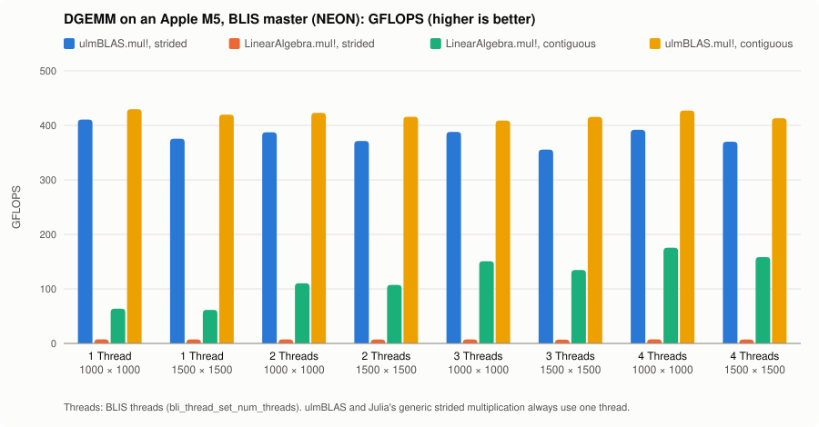
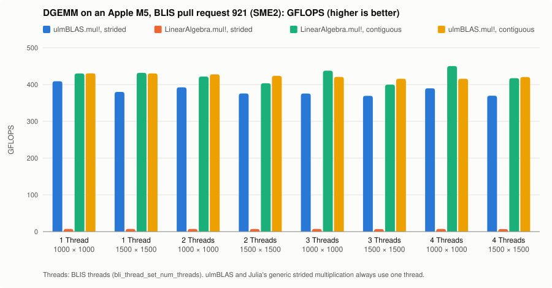

# Fourth Benchmark on my MacBook: BLIS

The same benchmark as the [first](benchmark_001.md), [second](benchmark_002.md)
and [third](benchmark_003.md) one, with [BLIS](https://github.com/flame/blis)
behind `LinearAlgebra.mul!`.  Three BLIS builds were measured:

| | BLIS | configuration on the M5 | DGEMM micro-kernel actually called |
|---|---|---|---|
| main result | master `a8037cfc` (3.0), own build, pthreads | `firestorm` | `bli_dgemm_armv8a_asm_8x6r` (NEON) |
| SME2 | pull request [#921](https://github.com/flame/blis/pull/921) `235ef8ec` (open, not merged), own build, pthreads | `m4sme_p` | `bli_dgemm_armsme_int_4SVLx2SVL` (SME2, 32 × 16) |
| BLISBLAS.jl | `blis_jll` 2.0.0+2 (BLIS 2.0) of BLISBLAS.jl 0.2.0, OpenMP | `firestorm` | NEON (same configuration as master) |

Official BLIS has no configuration that uses SME/SME2: on the M5 its
hardware detection selects `firestorm`, a NEON configuration for the
Apple M1.  The SME2 kernels exist only in pull request #921, which adds
the sub-configurations `m4sme_p` and `m4sme_e` for the Apple M4; its
hardware detection selects `m4sme_p` when the CPU reports `FEAT_SME2`.

Versions, commits, compiler (Homebrew clang 23.1.4), configure options and
the kernel check are in the
[build record](../bench/results/2026-10-31-apple-m5-blis-build.txt).

## Which kernel runs

[`check_blis_kernel.sh`](../bench/check_blis_kernel.sh) calls `dgemm_` of
a BLIS build once ([`blis_dgemm.c`](../bench/blis_dgemm.c)) under lldb,
with breakpoints on all BLIS DGEMM micro-kernels (including the `dgemmsup`
kernels for small matrices) and packing kernels, and lists the functions
that were hit.  For n = 1000 and 1500 with 1 and 4 threads:

- master: only `bli_dgemm_armv8a_asm_8x6r` and `bli_dpackm_armv8a_int_6x8`
  (20875 micro-kernel calls for n = 1000);
- pull request #921: only `bli_dgemm_armsme_int_4SVLx2SVL` and
  `bli_dpackm_armsme_int_4SVLx2SVL` (2016 = 32 · 63 micro-kernel calls for
  n = 1000).

## BLIS in Julia

[BLISBLAS.jl](https://github.com/JuliaLinearAlgebra/BLISBLAS.jl) 0.2.0
works with Julia 1.13.3: `using BLISBLAS` forwards Julia's BLAS calls via
libblastrampoline (LBT) to `blis_jll` (and LAPACK to `LAPACK_jll`), and the
results are correct.  But `blis_jll` is BLIS 2.0, built by Yggdrasil with
the generic `firestorm` configuration and OpenMP.  To measure the current
BLIS and the SME2 pull request, the benchmark script forwards LBT itself to
a BLIS library: built with `configure -b 64` (64-bit BLAS integers, symbols
`dgemm_` without suffix), and LBT detects the ILP64 interface.  With
`BLIS_LIBRARY=blis_jll` the same script measures the BLIS of BLISBLAS.jl
(symbols `dgemm_64_`).

Before measuring, [`gemm_blis.jl`](../bench/gemm_blis.jl) checks that LBT
forwards `dgemm_` to the `dgemm_` of the BLIS library (function pointer
comparison), that `LinearAlgebra.mul!` makes exactly one `dgemm_` call for
the contiguous matrix and none for the strided view, that `ulmBLAS.mul!`
makes no `dgemm_` call and calls `ulmblas_dgemm_strided` of ulmBLAS, and it
compares all results with Julia's generic multiplication.

## Threads

BLIS takes a number of threads: the script sets 1 to 4 with
`bli_thread_set_num_threads` and reads it back with
`bli_thread_get_num_threads`, all in one process.  As in the
[third benchmark](benchmark_003.md), the output also reports the observed
parallelism (process CPU time / wall time, `CPU/wall`).  ulmBLAS and the
generic Julia multiplication use one thread.

## Reproduce

```sh
# BLIS master or pull request 921 (git fetch origin pull/921/head)
./configure --prefix=$PREFIX -t pthreads -i 64 -b 64 CC=clang auto
make -j10 && make install

cd bench
./check_blis_kernel.sh $PREFIX/lib
ULMBLAS_LIBRARY=/path/to/libulmblas_lbt.dylib \
BLIS_LIBRARY=$PREFIX/lib/libblis.dylib julia --project=. gemm_blis.jl

# BLIS of BLISBLAS.jl: an environment with blis_jll in the load path
JULIA_LOAD_PATH="@:/path/to/env-with-blis_jll:@stdlib" \
BLIS_LIBRARY=blis_jll julia --project=. gemm_blis.jl
```

## Output on my M5: BLIS master

```text
library of ulmBLAS: /Users/lehn/git/ulmBLAS.jl/dev/lib/libulmblas_lbt.dylib
LBT after `using ulmBLAS`: dgemm_ -> ulmBLAS
LBT for this benchmark:   dgemm_ -> BLIS (dgemm_ of libblis.dylib, ILP64)
ulmBLAS.mul!:             ulmblas_dgemm_strided of libulmblas_lbt.dylib
dgemm_ calls through LBT: LinearAlgebra.mul! strided 0, contiguous 1; ulmBLAS.mul! 0
BLIS 3.0: configuration firestorm, BLAS integer 64 bit, pthreads true, OpenMP false
CPU: Apple M5 (4 performance + 6 efficiency cores), macOS 26.6 (25G72), Julia 1.13.3, Julia threads 1

case                            n     backend                  requested      ms    GFLOPS CPU/wall  bytes allocs
ulmBLAS.mul!, strided           1000  ulmBLAS (1 thread)               -     4.9     410.7     1.00      0      0
LinearAlgebra.mul!, strided     1000  generic Julia (1 thread)         -   268.9       7.4     1.00     64      1
LinearAlgebra.mul!, contiguous  1000  BLIS                             1    31.4      63.7     1.00      0      0
ulmBLAS.mul!, contiguous        1000  ulmBLAS (1 thread)               -     4.7     429.7     1.00      0      0
ulmBLAS.mul!, strided           1500  ulmBLAS (1 thread)               -    18.0     375.5     1.00      0      0
LinearAlgebra.mul!, strided     1500  generic Julia (1 thread)         -   928.5       7.3     1.00     64      1
LinearAlgebra.mul!, contiguous  1500  BLIS                             1   109.6      61.6     1.00      0      0
ulmBLAS.mul!, contiguous        1500  ulmBLAS (1 thread)               -    16.1     419.7     1.00      0      0
ulmBLAS.mul!, strided           1000  ulmBLAS (1 thread)               -     5.2     387.3     1.00      0      0
LinearAlgebra.mul!, strided     1000  generic Julia (1 thread)         -   273.2       7.3     1.00     64      1
LinearAlgebra.mul!, contiguous  1000  BLIS                             2    18.1     110.3     2.00      0      0
ulmBLAS.mul!, contiguous        1000  ulmBLAS (1 thread)               -     4.7     423.0     1.00      0      0
ulmBLAS.mul!, strided           1500  ulmBLAS (1 thread)               -    18.2     371.3     1.00      0      0
LinearAlgebra.mul!, strided     1500  generic Julia (1 thread)         -   947.4       7.1     1.00     64      1
LinearAlgebra.mul!, contiguous  1500  BLIS                             2    62.9     107.3     2.00      0      0
ulmBLAS.mul!, contiguous        1500  ulmBLAS (1 thread)               -    16.2     415.8     1.00      0      0
ulmBLAS.mul!, strided           1000  ulmBLAS (1 thread)               -     5.2     387.9     1.00      0      0
LinearAlgebra.mul!, strided     1000  generic Julia (1 thread)         -   272.5       7.3     1.00     64      1
LinearAlgebra.mul!, contiguous  1000  BLIS                             3    13.3     150.8     2.99      0      0
ulmBLAS.mul!, contiguous        1000  ulmBLAS (1 thread)               -     4.9     408.8     1.00      0      0
ulmBLAS.mul!, strided           1500  ulmBLAS (1 thread)               -    19.0     355.4     1.00      0      0
LinearAlgebra.mul!, strided     1500  generic Julia (1 thread)         -   966.1       7.0     1.00     64      1
LinearAlgebra.mul!, contiguous  1500  BLIS                             3    50.2     134.6     3.00      0      0
ulmBLAS.mul!, contiguous        1500  ulmBLAS (1 thread)               -    16.2     415.6     1.00      0      0
ulmBLAS.mul!, strided           1000  ulmBLAS (1 thread)               -     5.1     391.8     1.00      0      0
LinearAlgebra.mul!, strided     1000  generic Julia (1 thread)         -   269.6       7.4     1.00     64      1
LinearAlgebra.mul!, contiguous  1000  BLIS                             4    11.4     175.5     3.99      0      0
ulmBLAS.mul!, contiguous        1000  ulmBLAS (1 thread)               -     4.7     427.2     1.00      0      0
ulmBLAS.mul!, strided           1500  ulmBLAS (1 thread)               -    18.2     370.0     1.00      0      0
LinearAlgebra.mul!, strided     1500  generic Julia (1 thread)         -   939.2       7.2     1.00     64      1
LinearAlgebra.mul!, contiguous  1500  BLIS                             4    42.7     158.3     3.99      0      0
ulmBLAS.mul!, contiguous        1500  ulmBLAS (1 thread)               -    16.3     413.1     1.00      0      0
```



## Output on my M5: BLIS pull request 921 (SME2)

```text
library of ulmBLAS: /Users/lehn/git/ulmBLAS.jl/dev/lib/libulmblas_lbt.dylib
LBT after `using ulmBLAS`: dgemm_ -> ulmBLAS
LBT for this benchmark:   dgemm_ -> BLIS (dgemm_ of libblis.dylib, ILP64)
ulmBLAS.mul!:             ulmblas_dgemm_strided of libulmblas_lbt.dylib
dgemm_ calls through LBT: LinearAlgebra.mul! strided 0, contiguous 1; ulmBLAS.mul! 0
BLIS 3.0: configuration m4sme_p, BLAS integer 64 bit, pthreads true, OpenMP false
CPU: Apple M5 (4 performance + 6 efficiency cores), macOS 26.6 (25G72), Julia 1.13.3, Julia threads 1

case                            n     backend                  requested      ms    GFLOPS CPU/wall  bytes allocs
ulmBLAS.mul!, strided           1000  ulmBLAS (1 thread)               -     4.9     409.0     1.00      0      0
LinearAlgebra.mul!, strided     1000  generic Julia (1 thread)         -   271.1       7.4     1.00     64      1
LinearAlgebra.mul!, contiguous  1000  BLIS                             1     4.6     430.2     1.00      0      0
ulmBLAS.mul!, contiguous        1000  ulmBLAS (1 thread)               -     4.6     430.5     1.00      0      0
ulmBLAS.mul!, strided           1500  ulmBLAS (1 thread)               -    17.8     380.0     1.00      0      0
LinearAlgebra.mul!, strided     1500  generic Julia (1 thread)         -   920.3       7.3     1.00     64      1
LinearAlgebra.mul!, contiguous  1500  BLIS                             1    15.6     431.8     1.00      0      0
ulmBLAS.mul!, contiguous        1500  ulmBLAS (1 thread)               -    15.7     430.4     1.00      0      0
ulmBLAS.mul!, strided           1000  ulmBLAS (1 thread)               -     5.1     392.5     1.00      0      0
LinearAlgebra.mul!, strided     1000  generic Julia (1 thread)         -   273.7       7.3     1.00     64      1
LinearAlgebra.mul!, contiguous  1000  BLIS                             2     4.7     421.8     2.00      0      0
ulmBLAS.mul!, contiguous        1000  ulmBLAS (1 thread)               -     4.7     427.8     1.00      0      0
ulmBLAS.mul!, strided           1500  ulmBLAS (1 thread)               -    18.0     375.9     1.00      0      0
LinearAlgebra.mul!, strided     1500  generic Julia (1 thread)         -   940.0       7.2     1.00     64      1
LinearAlgebra.mul!, contiguous  1500  BLIS                             2    16.7     403.6     2.00      0      0
ulmBLAS.mul!, contiguous        1500  ulmBLAS (1 thread)               -    15.9     423.9     1.00      0      0
ulmBLAS.mul!, strided           1000  ulmBLAS (1 thread)               -     5.3     375.7     1.00      0      0
LinearAlgebra.mul!, strided     1000  generic Julia (1 thread)         -   275.1       7.3     1.00     64      1
LinearAlgebra.mul!, contiguous  1000  BLIS                             3     4.6     437.8     2.99      0      0
ulmBLAS.mul!, contiguous        1000  ulmBLAS (1 thread)               -     4.8     420.9     1.00      0      0
ulmBLAS.mul!, strided           1500  ulmBLAS (1 thread)               -    18.3     369.3     1.00      0      0
LinearAlgebra.mul!, strided     1500  generic Julia (1 thread)         -   971.6       6.9     1.00     64      1
LinearAlgebra.mul!, contiguous  1500  BLIS                             3    16.9     399.8     2.99      0      0
ulmBLAS.mul!, contiguous        1500  ulmBLAS (1 thread)               -    16.2     415.9     1.00      0      0
ulmBLAS.mul!, strided           1000  ulmBLAS (1 thread)               -     5.1     389.8     1.00      0      0
LinearAlgebra.mul!, strided     1000  generic Julia (1 thread)         -   271.7       7.4     1.00     64      1
LinearAlgebra.mul!, contiguous  1000  BLIS                             4     4.4     450.4     3.98      0      0
ulmBLAS.mul!, contiguous        1000  ulmBLAS (1 thread)               -     4.8     415.9     1.00      0      0
ulmBLAS.mul!, strided           1500  ulmBLAS (1 thread)               -    18.3     369.7     1.00      0      0
LinearAlgebra.mul!, strided     1500  generic Julia (1 thread)         -   970.4       7.0     1.00     64      1
LinearAlgebra.mul!, contiguous  1500  BLIS                             4    16.2     417.4     3.99      0      0
ulmBLAS.mul!, contiguous        1500  ulmBLAS (1 thread)               -    16.1     420.5     1.00      0      0
```



## Output on my M5: BLIS of BLISBLAS.jl

<details>
<summary>Output (no chart: the BLIS results are within 6% of BLIS master)</summary>

```text
library of ulmBLAS: /Users/lehn/git/ulmBLAS.jl/dev/lib/libulmblas_lbt.dylib
LBT after `using ulmBLAS`: dgemm_ -> ulmBLAS
LBT for this benchmark:   dgemm_ -> BLIS (dgemm_64_ of libblis.4.0.0.dylib, ILP64)
ulmBLAS.mul!:             ulmblas_dgemm_strided of libulmblas_lbt.dylib
dgemm_ calls through LBT: LinearAlgebra.mul! strided 0, contiguous 1; ulmBLAS.mul! 0
BLIS 2.0: configuration firestorm, BLAS integer 64 bit, pthreads false, OpenMP true
CPU: Apple M5 (4 performance + 6 efficiency cores), macOS 26.6 (25G72), Julia 1.13.3, Julia threads 1

case                            n     backend                  requested      ms    GFLOPS CPU/wall  bytes allocs
ulmBLAS.mul!, strided           1000  ulmBLAS (1 thread)               -     4.8     415.9     1.00      0      0
LinearAlgebra.mul!, strided     1000  generic Julia (1 thread)         -   263.7       7.6     1.00     64      1
LinearAlgebra.mul!, contiguous  1000  BLIS                             1    30.5      65.6     1.00      0      0
ulmBLAS.mul!, contiguous        1000  ulmBLAS (1 thread)               -     4.6     438.9     1.00      0      0
ulmBLAS.mul!, strided           1500  ulmBLAS (1 thread)               -    17.6     383.5     1.00      0      0
LinearAlgebra.mul!, strided     1500  generic Julia (1 thread)         -   905.2       7.5     1.00     64      1
LinearAlgebra.mul!, contiguous  1500  BLIS                             1   108.2      62.4     1.00      0      0
ulmBLAS.mul!, contiguous        1500  ulmBLAS (1 thread)               -    15.5     436.8     1.00      0      0
ulmBLAS.mul!, strided           1000  ulmBLAS (1 thread)               -     5.0     398.9     1.00      0      0
LinearAlgebra.mul!, strided     1000  generic Julia (1 thread)         -   263.6       7.6     1.00     64      1
LinearAlgebra.mul!, contiguous  1000  BLIS                             2    18.1     110.6     2.00      0      0
ulmBLAS.mul!, contiguous        1000  ulmBLAS (1 thread)               -     4.6     435.3     1.00      0      0
ulmBLAS.mul!, strided           1500  ulmBLAS (1 thread)               -    17.7     380.9     1.00      0      0
LinearAlgebra.mul!, strided     1500  generic Julia (1 thread)         -   937.6       7.2     1.00     64      1
LinearAlgebra.mul!, contiguous  1500  BLIS                             2    63.1     106.9     2.00      0      0
ulmBLAS.mul!, contiguous        1500  ulmBLAS (1 thread)               -    15.9     423.7     1.00      0      0
ulmBLAS.mul!, strided           1000  ulmBLAS (1 thread)               -     5.1     391.1     1.00      0      0
LinearAlgebra.mul!, strided     1000  generic Julia (1 thread)         -   273.7       7.3     1.00     64      1
LinearAlgebra.mul!, contiguous  1000  BLIS                             3    13.4     149.0     2.99      0      0
ulmBLAS.mul!, contiguous        1000  ulmBLAS (1 thread)               -     4.7     428.2     1.00      0      0
ulmBLAS.mul!, strided           1500  ulmBLAS (1 thread)               -    17.9     376.3     1.00      0      0
LinearAlgebra.mul!, strided     1500  generic Julia (1 thread)         -   943.1       7.2     1.00     64      1
LinearAlgebra.mul!, contiguous  1500  BLIS                             3    49.4     136.6     3.00      0      0
ulmBLAS.mul!, contiguous        1500  ulmBLAS (1 thread)               -    16.2     417.6     1.00      0      0
ulmBLAS.mul!, strided           1000  ulmBLAS (1 thread)               -     5.1     391.2     1.00      0      0
LinearAlgebra.mul!, strided     1000  generic Julia (1 thread)         -   278.0       7.2     1.00     64      1
LinearAlgebra.mul!, contiguous  1000  BLIS                             4    10.8     184.9     3.99      0      0
ulmBLAS.mul!, contiguous        1000  ulmBLAS (1 thread)               -     4.8     420.9     1.00      0      0
ulmBLAS.mul!, strided           1500  ulmBLAS (1 thread)               -    17.9     376.6     1.00      0      0
LinearAlgebra.mul!, strided     1500  generic Julia (1 thread)         -   947.5       7.1     1.00     64      1
LinearAlgebra.mul!, contiguous  1500  BLIS                             4    43.5     155.2     3.99      0      0
ulmBLAS.mul!, contiguous        1500  ulmBLAS (1 thread)               -    16.1     420.1     1.00      0      0
```

</details>

## Some notes on that

- BLIS master (NEON) reaches 61.6 to 63.7 GFLOPS with one thread, about
  15% of ulmBLAS (419.7 to 429.7 GFLOPS).  It scales with the threads: the
  observed parallelism is 2.00, 2.99 and 3.99 for 2, 3 and 4 threads, and
  4 threads give 175.5 (n = 1000) and 158.3 GFLOPS (n = 1500), 41% and 38%
  of the single-threaded ulmBLAS.
- The BLIS of BLISBLAS.jl gives the same picture (62.4 to 184.9 GFLOPS):
  the gap to ulmBLAS comes from the NEON kernels of BLIS on this CPU, not
  from the Julia wrapper.
- With the SME2 kernels of pull request #921, one BLIS thread reaches 430.2
  (n = 1000) and 431.8 GFLOPS (n = 1500), the same as ulmBLAS in this run
  (430.5 and 430.4).  More threads keep all requested cores busy (CPU/wall
  2.00 to 3.99) but do not make it faster: 399.8 to 450.4 GFLOPS with 2 to
  4 threads.
- The strided case is unchanged: `LinearAlgebra.mul!` makes no BLAS call
  for the view (6.9 to 7.6 GFLOPS), `ulmBLAS.mul!` reaches 355 to 416
  GFLOPS.
- These are measurements of a pull request that is still under review; the
  merged BLIS may behave differently.
