# Netlib LAPACK on top of ulmBLAS

An experiment, not part of the package: Netlib LAPACK 3.12.1, with every
BLAS call executed by ulmBLAS, in Julia, and its LU factorization
(`DGETRF`) compared with Julia's default LAPACK (OpenBLAS).  The package
and its public API are unchanged; everything is in this directory.

## Approach

`UlmBLAS.forward()` replaces only the BLAS routines in libblastrampoline
(LBT).  `LinearAlgebra.LAPACK.getrf!` still runs OpenBLAS's `dgetrf`,
which calls OpenBLAS's kernels directly, not through LBT: ulmBLAS is
never called (shown by `verify.jl`, below).  A LAPACK whose BLAS calls go
through LBT is needed:

```
Julia ──dgetrf_64_──▶ LBT ──▶ Netlib liblapack ──dgemm_64_, dtrsm_64_, ...──▶ LBT ──▶ ulmBLAS
                                  (dgetrf2, dlaswp, ilaenv: inside liblapack)
```

- `build.sh OUT [JULIA]` builds Netlib LAPACK 3.12.1 (release tarball,
  sha256 checked) with CMake as a shared library **linked against the
  libblastrampoline of the Julia installation**.  The only change of the
  sources: `STOP` removed from `xerbla.f` (as in Yggdrasil's LAPACK_jll).
- Configuration in LBT (`common.jl`), on top of OpenBLAS (`clear=false`):
  `UlmBLAS.forward()` for the BLAS routines, then
  `BLAS.lbt_forward(liblapack; clear=false, suffix_hint="64_")` for the
  LAPACK routines.  Everything neither library provides stays with OpenBLAS.
  LBT does provide the separation of BLAS and LAPACK: it forwards each
  symbol separately, and the library loaded last wins for the symbols it
  exports.  Netlib LAPACK exports no BLAS routines (only `lsame` and
  `xerbla`), so the BLAS forwards of ulmBLAS stay in place.
- Three configurations: `openblas` (Julia's default), `netlib_ulmblas`, and
  `netlib_openblas` (the same Netlib LAPACK with OpenBLAS's BLAS, to separate
  the effect of the LAPACK algorithm from that of the BLAS).

**Interface.** Julia uses ILP64 with the suffix `64_`.  The library is
built with LAPACK's extended `_64` API (`BUILD_INDEX64_EXT_API`): every
routine is compiled with `-fdefault-integer-8` and renamed by
`SRC/lapack_64.h`, so gfortran emits `dgetrf_64_` and calls `dgemm_64_`,
`dtrsm_64_`, ... (132 BLAS routines, all imported from LBT, all provided by
ulmBLAS).  The library also contains the LP64 routines without suffix
(part of that build); LBT is told `suffix_hint="64_"` and they are not
used.  The hidden lengths of character arguments (gfortran: `size_t`
after the last argument) pass through LBT unchanged.

**Linkage.** `liblapack` needs `libblastrampoline.so.5`
(`@rpath/libblastrampoline.5.dylib` on macOS, with an rpath to the Julia
used for the build).  At run time this must be the instance Julia has
loaded, otherwise its forwards would be empty; the counters of
`verify.jl` show that the calls go through Julia's LBT.  LAPACK's calls of
its own routines (`dgetrf2_64_`, `dlaswp_64_`, `ilaenv_64_`) are bound
inside `liblapack`, not through LBT (zero calls through LBT; on Linux also
the bindings of the dynamic linker, `bindings.jl` with `LD_DEBUG`).

## Verification of the symbol resolution

`verify.jl` reports, for each configuration, where LBT forwards each BLAS
routine liblapack imports (`nm -u`, `lbt_get_forward`, `dladdr`), and then
replaces the LBT entries of `dgemm`, `dtrsm`, `idamax`, `dscal`, `dswap`,
`dgetrf`, `dgetrf2`, `dlaswp` and `ilaenv` by counters that call the
previous target, for one `DGETRF` with n = 1000.  It fails unless DGEMM
and DTRSM reach ulmBLAS.

Result (Ice Lake and Zen 4, Julia 1.13.3; the same on an Apple M5,
macOS): one `DGETRF` with n = 1000

| through LBT | `openblas` | `netlib_ulmblas` | `netlib_openblas` |
|---|---|---|---|
| `dgetrf` | 1 → OpenBLAS | 1 → liblapack | 1 → liblapack |
| `dgemm`, `dtrsm`, `idamax`, `dscal` | 0 each | 999 each → ulmBLAS | 999 each → OpenBLAS |
| `dgetrf2`, `dlaswp`, `ilaenv`, `dswap` | 0 | 0 | 0 |
| 132 BLAS imports of liblapack | → OpenBLAS | all → ulmBLAS | → OpenBLAS |

DGEMM does 95.4% and DTRSM 4.6% of the flops.  With Julia's default not a
single BLAS call goes through LBT: OpenBLAS's LU uses its own kernels, so
`UlmBLAS.forward()` alone does not change `lu`.  On Linux the dynamic
linker binds `dgemm_64_`, `dtrsm_64_`, `idamax_64_`, `dscal_64_` of
liblapack to Julia's `libblastrampoline.so.5`, and `dgetrf2_64_`,
`dlaswp_64_`, `ilaenv_64_` to liblapack itself
(`results/*.bindings.txt`); `libgfortran.so.5` is Julia's.

## Correctness

`test.jl`: `DGETRF` of 44 matrices: square (n = 1 to 1000, around the
block size 64), rectangular (1×50 to 1000×257), leading dimension larger
than m, matrices with known pivots (A = P·L·U with |L| ≤ 1/2), a pivot in
the last row at every step, zero and all-ones matrices, a zero column at
k = 3 to 300 (INFO = k).  Checked: INFO and the pivots equal those of
OpenBLAS (and the known ones), `i ≤ ipiv[i] ≤ m` (1-based, row i
interchanged with row ipiv[i]), residual
‖P·A − L·U‖₁ / (‖A‖₁ max(m,n) ε) ≤ 30, rows beyond m unchanged, and
`lu(A)` and `A \ b` of LinearAlgebra.

Result: 632 of 632 checks pass for `netlib_ulmblas` and `netlib_openblas`
on Ice Lake, Zen 4 and an Apple M5; the pivots equal those of OpenBLAS in
every case, residuals ≤ 0.05 (`results/*.test.txt`).

## Benchmarks

`bench.jl`: median time of a complete `DGETRF` call (n×n, through LBT as
LinearAlgebra calls it, pivoting and all BLAS calls included), one
thread (`BLAS.set_num_threads(1)`, `OPENBLAS_NUM_THREADS=1`, Julia with one
thread, pinned to one core), the same matrix (randn, seed n) and the same
Julia for all configurations, which take turns for each n.

bwUniCluster 3.0, one exclusive node each (dev partitions, 2026-11-02),
Julia 1.13.3 (OpenBLAS 0.3.30 of Julia), Netlib LAPACK built with
gfortran 14.2 (`-O3`), ulmBLAS of the package's artifact (6c554eec):

- Intel Xeon Platinum 8358 (Ice Lake, 2.6 GHz), ulmBLAS variant `skylakex`
  (`results/2026-11-02-icelake-xeon8358.*`)
- AMD EPYC 9454 (Zen 4), variant `zen4` (`results/2026-11-02-zen4-epyc9454.*`)

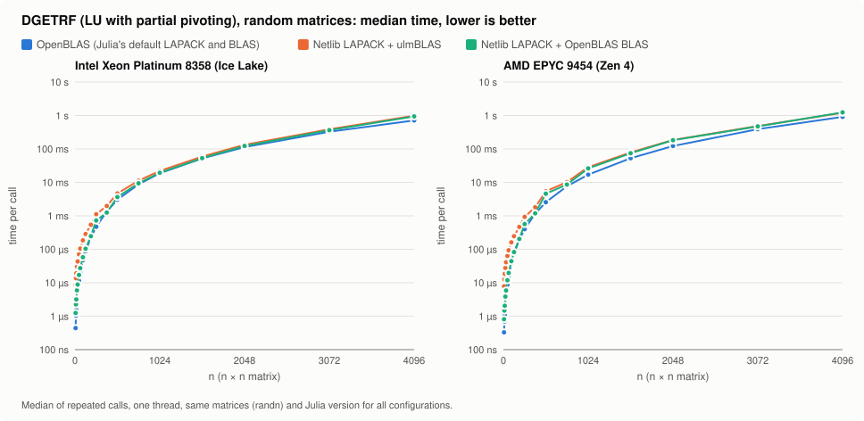

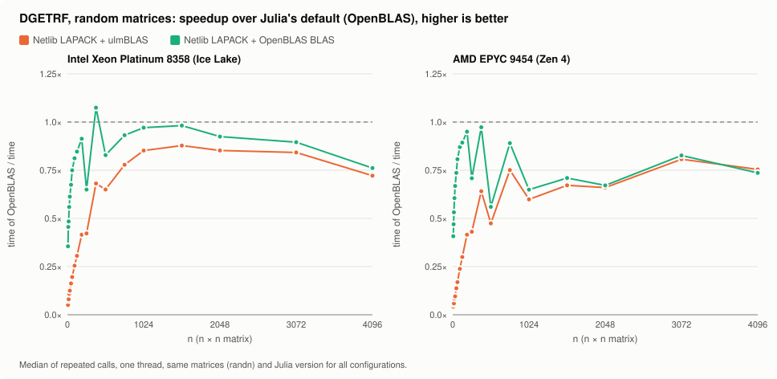

Median time and speedup (time of OpenBLAS / time; below 1 = slower than
Julia's default):

| n | Ice Lake OpenBLAS | Netlib + ulmBLAS | Netlib + OpenBLAS | Zen 4 OpenBLAS | Netlib + ulmBLAS | Netlib + OpenBLAS |
|---:|---:|---:|---:|---:|---:|---:|
| 8 | 0.44 µs | 8.7 µs (0.05×) | 1.2 µs (0.36×) | 0.33 µs | 7.8 µs (0.04×) | 0.81 µs (0.41×) |
| 32 | 5.4 µs | 43 µs (0.12×) | 8.8 µs (0.61×) | 3.9 µs | 41 µs (0.10×) | 5.9 µs (0.67×) |
| 128 | 88 µs | 286 µs (0.31×) | 103 µs (0.85×) | 74 µs | 246 µs (0.30×) | 82 µs (0.89×) |
| 512 | 3.0 ms | 4.7 ms (0.65×) | 3.7 ms (0.83×) | 2.6 ms | 5.4 ms (0.47×) | 4.6 ms (0.56×) |
| 1024 | 18.8 ms | 22.1 ms (0.85×) | 19.4 ms (0.97×) | 17.1 ms | 28.5 ms (0.60×) | 26.3 ms (0.65×) |
| 2048 | 114 ms | 133 ms (0.85×) | 123 ms (0.92×) | 123 ms | 186 ms (0.66×) | 183 ms (0.67×) |
| 4096 | 0.72 s | 0.99 s (0.72×) | 0.94 s (0.76×) | 0.91 s | 1.21 s (0.75×) | 1.24 s (0.74×) |

- Netlib LAPACK on top of ulmBLAS is slower than Julia's default for every
  size: 0.72–0.88× of OpenBLAS for n ≥ 768 on Ice Lake, 0.6–0.8× on Zen 4,
  and much slower for small matrices (0.04–0.3× for n ≤ 128).
- Large n: most of the gap is the LAPACK algorithm, not the BLAS: Netlib
  LAPACK with OpenBLAS's BLAS is nearly as slow.  For n ≥ 1024 ulmBLAS
  makes it 2–8% slower on Zen 4 (2% faster at n = 4096) and 5–14% slower
  on Ice Lake.  Both Netlib configurations drop at n = 256 and 512 (and
  1024 on Zen 4), leading dimensions that are powers of two.
- Small n: the gap is in the BLAS calls.  Netlib's recursive panel
  factorization makes about 4 BLAS calls per column (n = 8: 7 DGEMM,
  7 DTRSM, 8 IDAMAX, 8 DSCAL), and these tiny calls cost about 250 ns
  more each in ulmBLAS than in OpenBLAS (n = 8: 8.7 µs against 1.2 µs with
  the same LAPACK).  The cause within ulmBLAS was not investigated here.

## Matrices diagonally dominant by columns

The question: how much of the difference comes from the row interchanges?
`test_matrix(:coldom, n)` (`common.jl`) has the off-diagonal entries of the
random matrix (randn, seed n) and `a[i,i] = ±1.25 Σ_{j≠i} |a[j,i]|`:
strictly diagonally dominant **by columns**.  Then partial pivoting chooses
the diagonal in every step (column dominance is preserved by the
elimination), so `IPIV[i] == i`.  Dominance by rows would not be enough:
`[2 1; 3 4]` is dominant by rows and needs an interchange (checked in
`coldom.jl`).

`coldom.jl` checks for all benchmark sizes and all three configurations:
INFO = 0, `ipiv[i] == i`, pivots equal to OpenBLAS, residual
‖A − L·U‖₁ / (‖A‖₁ n ε) ≤ 30: 231 of 231 checks pass on Ice Lake and Zen 4
(`results/*-coldom.coldom.txt`); `bench.jl` stops if a column-dominant
matrix gets an interchange.  `cluster/job-coldom.sh` runs it and
`MATRIX=dense,coldom bench.jl`: random and column-dominant matrices take
turns for each n in the same job (jobs 8243962, Ice Lake uc2n602, and
8243963, Zen 4 uc3n069; `results/*-coldom.*`).  The random matrices of
these jobs agree with the first run within ±4% (mean within 1% for
n ≥ 768, Ice Lake on another node of the same type).

**What is measured.** `DGETRF` without row interchanges, not an LU without
pivoting: the pivot search (IDAMAX on every column), the comparisons and
the loops of DLASWP over the pivot vector remain; only the swaps of rows
(and their memory traffic) are gone.  In both Netlib configurations the
swaps are done by Netlib's DLASWP (bound inside liblapack, 0 calls through
LBT), not by OpenBLAS's `dlaswp`; OpenBLAS's own LU has its own.

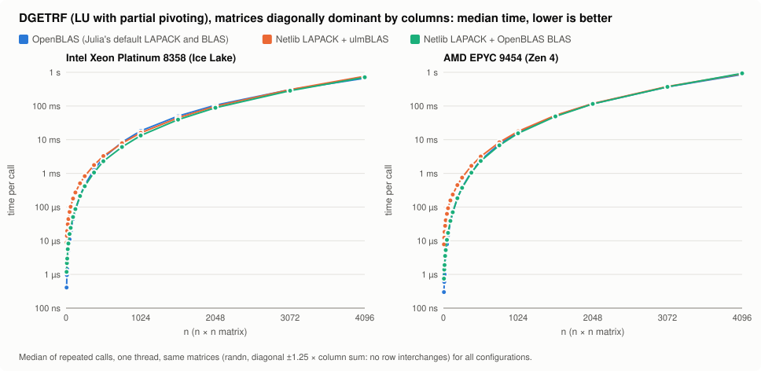

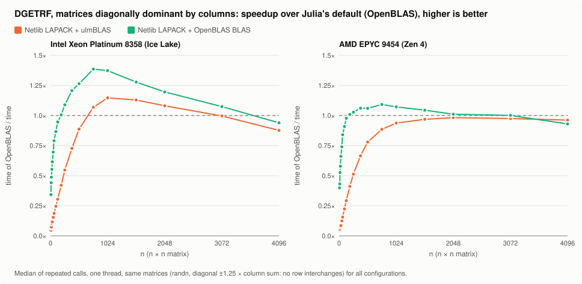

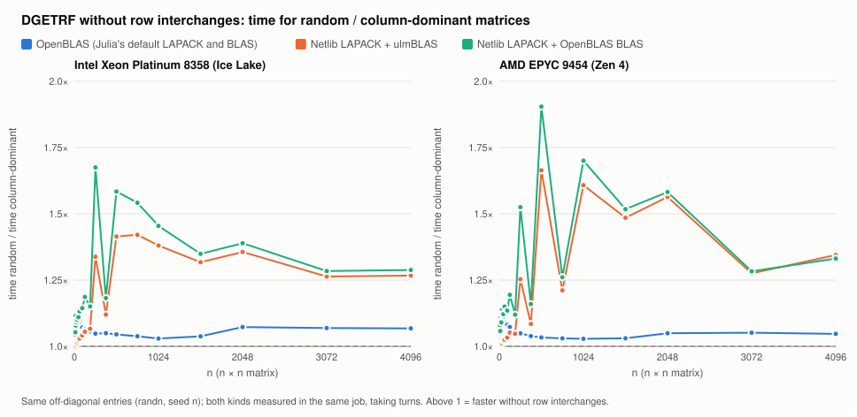

Gain without row interchanges (time random / time column-dominant) and
speedup over OpenBLAS (time of OpenBLAS / time, random → column-dominant):

| n | Ice Lake gain OpenBLAS | Netlib + ulmBLAS | Netlib + OpenBLAS | speedup Netlib + ulmBLAS | Zen 4 gain OpenBLAS | Netlib + ulmBLAS | Netlib + OpenBLAS | speedup Netlib + ulmBLAS |
|---:|---:|---:|---:|---:|---:|---:|---:|---:|
| 8 | 1.11 | 1.00 | 1.04 | 0.05 → 0.05 | 1.07 | 1.02 | 1.08 | 0.04 → 0.04 |
| 32 | 1.09 | 1.02 | 1.10 | 0.12 → 0.12 | 1.14 | 1.01 | 1.12 | 0.10 → 0.09 |
| 128 | 1.06 | 1.06 | 1.19 | 0.31 → 0.30 | 1.07 | 1.05 | 1.19 | 0.30 → 0.29 |
| 256 | 1.05 | 1.34 | 1.68 | 0.43 → 0.55 | 1.05 | 1.25 | 1.53 | 0.43 → 0.51 |
| 512 | 1.04 | 1.41 | 1.58 | 0.66 → 0.89 | 1.03 | 1.66 | 1.90 | 0.48 → 0.78 |
| 768 | 1.04 | 1.42 | 1.54 | 0.78 → 1.07 | 1.03 | 1.21 | 1.26 | 0.75 → 0.89 |
| 1024 | 1.03 | 1.38 | 1.45 | 0.86 → 1.15 | 1.03 | 1.61 | 1.70 | 0.60 → 0.94 |
| 1536 | 1.04 | 1.32 | 1.35 | 0.89 → 1.13 | 1.03 | 1.49 | 1.52 | 0.67 → 0.97 |
| 2048 | 1.07 | 1.36 | 1.39 | 0.86 → 1.08 | 1.05 | 1.56 | 1.58 | 0.66 → 0.98 |
| 3072 | 1.07 | 1.26 | 1.28 | 0.84 → 1.00 | 1.05 | 1.28 | 1.28 | 0.80 → 0.97 |
| 4096 | 1.07 | 1.27 | 1.29 | 0.74 → 0.88 | 1.05 | 1.34 | 1.33 | 0.75 → 0.96 |

- **Faster without row interchanges:** Netlib LAPACK 1.2–1.9× for
  n ≥ 512 and 1.1–1.7× at 256 and 384 (8–40% of the time of Netlib +
  ulmBLAS are the swaps), with both BLAS; OpenBLAS's LU only 3–7% for n ≥ 256 (its swaps are cheap).
  For n ≤ 128 the gains are small (Netlib + ulmBLAS 0–6%, the others
  4–19%).
- **The gap at large n is mostly Netlib's DLASWP:** of the difference
  between Netlib + ulmBLAS and OpenBLAS for random matrices, 89–97% is
  gone on Zen 4 for n = 1024–4096; on Ice Lake Netlib + ulmBLAS becomes
  faster than OpenBLAS for n = 768–2048 and equal at 3072 (63% of the gap
  remains at 4096).  The gap for small matrices does not change: it is the
  cost of the tiny BLAS calls.
- **The power-of-two drops** at n = 256, 512 (and 1024 on Zen 4) disappear
  for both Netlib configurations: they are caused by the row interchanges
  of Netlib's DLASWP, which touch one element per column with stride
  lda = n (cache conflicts for powers of two).  The gain peaks exactly at
  these sizes.
- **ulmBLAS against OpenBLAS's BLAS** (same LAPACK, time Netlib + OpenBLAS
  / time Netlib + ulmBLAS) stays about the same: Ice Lake 0.88–0.95 →
  0.84–0.93, Zen 4 0.92–1.02 → 0.87–1.03 for n ≥ 1024; without the swaps
  the BLAS is a larger part of the time.

## Time per BLAS routine: ulmBLAS against OpenBLAS's BLAS

Where Netlib LAPACK + ulmBLAS loses against Netlib LAPACK + OpenBLAS's
BLAS (the same LAPACK, the same DLASWP, the same block sizes: NB = 64 of
ILAENV, 32 columns in DLASWP).  `profile.jl` replaces the LBT entries of
the four BLAS routines DGETRF calls (DGEMM, DTRSM, IDAMAX, DSCAL) by
wrappers that time every call (`time_ns`) and call the previous target.
For each n, DGETRF is called repeatedly (0.5 s, at least 5 calls); per
call the time in each routine and the rest ("rest of DGETRF": DLASWP and
the code of DGETRF and DGETRF2 in liblapack, plus the wrappers' own cost)
are recorded, medians reported.  "DGETRF" is the time without wrappers.
The wrappers cost 40–65 ns per BLAS call, which matters only for the
smallest n (n = 8: about 30 calls; "rest" there is mostly this cost).
Jobs 8244291 (Ice Lake, uc2n602) and 8244292 (Zen 4, uc3n070),
`cluster/job-profile.sh`, `results/*-profile.*`.

Random matrices, time per DGETRF with OpenBLAS's BLAS → with ulmBLAS
(ratio), Intel Xeon Platinum 8358 (Ice Lake):

| n | DGEMM | DTRSM | IDAMAX | DSCAL | rest of DGETRF | DGETRF |
|---:|---:|---:|---:|---:|---:|---:|
| 8 | 0.35 → 1.67 µs (4.76×) | 0.78 → 7.12 µs (9.13×) | 0.21 → 0.28 µs (1.35×) | 0.19 → 0.16 µs (0.82×) | 1.12 → 1.17 µs (1.05×) | 1.25 → 8.92 µs (7.15×) |
| 32 | 2.33 → 9.77 µs (4.20×) | 5.34 → 33.9 µs (6.35×) | 1.07 → 1.64 µs (1.54×) | 0.88 → 0.70 µs (0.80×) | 5.29 → 5.58 µs (1.05×) | 8.81 → 43.5 µs (4.94×) |
| 128 | 24.2 → 91.8 µs (3.80×) | 60.4 → 179 µs (2.96×) | 5.90 → 10.7 µs (1.82×) | 4.18 → 3.89 µs (0.93×) | 34.4 → 35.6 µs (1.04×) | 104 → 287 µs (2.77×) |
| 512 | 1.32 → 1.91 ms (1.45×) | 941 → 1302 µs (1.38×) | 50.6 → 123 µs (2.44×) | 29.7 → 29.5 µs (0.99×) | 1.43 → 1.44 ms (1.01×) | 3.65 → 4.67 ms (1.28×) |
| 1024 | 9.55 → 11.6 ms (1.21×) | 3.72 → 4.23 ms (1.14×) | 179 → 424 µs (2.37×) | 102 → 94.7 µs (0.93×) | 6.09 → 6.12 ms (1.00×) | 19.4 → 22.2 ms (1.14×) |
| 2048 | 73.0 → 81.0 ms (1.11×) | 16.9 → 18.5 ms (1.09×) | 630 → 1510 µs (2.40×) | 359 → 347 µs (0.97×) | 33.0 → 33.0 ms (1.00×) | 123 → 134 ms (1.08×) |
| 4096 | 637 → 679 ms (1.07×) | 70.1 → 78.7 ms (1.12×) | 2.33 → 5.67 ms (2.44×) | 1.41 → 1.38 ms (0.98×) | 208 → 208 ms (1.00×) | 918 → 972 ms (1.06×) |

AMD EPYC 9454 (Zen 4):

| n | DGEMM | DTRSM | IDAMAX | DSCAL | rest of DGETRF | DGETRF |
|---:|---:|---:|---:|---:|---:|---:|
| 8 | 0.28 → 0.98 µs (3.53×) | 0.49 → 6.60 µs (13.47×) | 0.19 → 0.18 µs (0.95×) | 0.19 → 0.17 µs (0.90×) | 0.94 → 0.96 µs (1.02×) | 0.79 → 7.77 µs (9.84×) |
| 32 | 1.79 → 5.47 µs (3.06×) | 3.53 → 33.9 µs (9.60×) | 0.89 → 0.92 µs (1.03×) | 0.83 → 0.78 µs (0.94×) | 4.38 → 4.49 µs (1.03×) | 5.89 → 40.5 µs (6.87×) |
| 128 | 26.2 → 53.0 µs (2.02×) | 43.0 → 175 µs (4.06×) | 4.50 → 6.42 µs (1.43×) | 3.82 → 3.64 µs (0.95×) | 29.3 → 29.6 µs (1.01×) | 84.0 → 246 µs (2.93×) |
| 512 | 1.64 → 1.80 ms (1.10×) | 663 → 1271 µs (1.92×) | 33.8 → 90.2 µs (2.66×) | 22.9 → 22.3 µs (0.98×) | 2.34 → 2.34 ms (1.00×) | 4.61 → 5.44 ms (1.18×) |
| 1024 | 12.8 → 13.3 ms (1.04×) | 2.61 → 4.06 ms (1.55×) | 123 → 348 µs (2.83×) | 77.7 → 74.5 µs (0.96×) | 10.8 → 10.8 ms (1.00×) | 26.2 → 28.3 ms (1.08×) |
| 2048 | 104 → 103 ms (0.99×) | 10.5 → 14.4 ms (1.37×) | 410 → 1284 µs (3.13×) | 251 → 243 µs (0.97×) | 67.6 → 67.7 ms (1.00×) | 183 → 186 ms (1.02×) |
| 4096 | 885 → 839 ms (0.95×) | 43.1 → 56.1 ms (1.30×) | 1.47 → 4.83 ms (3.28×) | 903 → 880 µs (0.97×) | 310 → 310 ms (1.00×) | 1239 → 1209 ms (0.98×) |

For each routine, the time per DGETRF with OpenBLAS's BLAS and with
ulmBLAS (top, log scale) and the ratio (bottom), random matrices (the
column-dominant matrices make the same BLAS calls and give the same
curves; only the rest of DGETRF, DLASWP, differs):

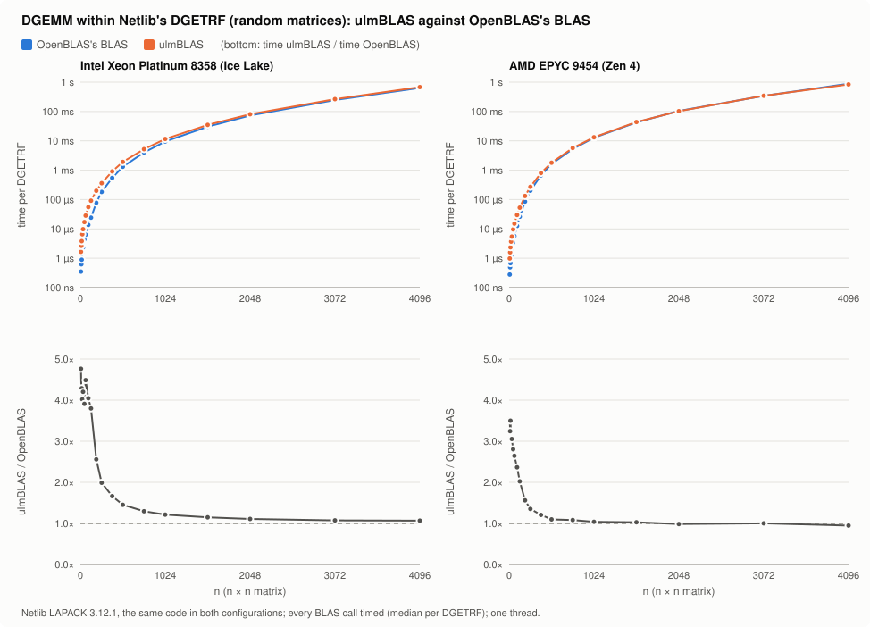

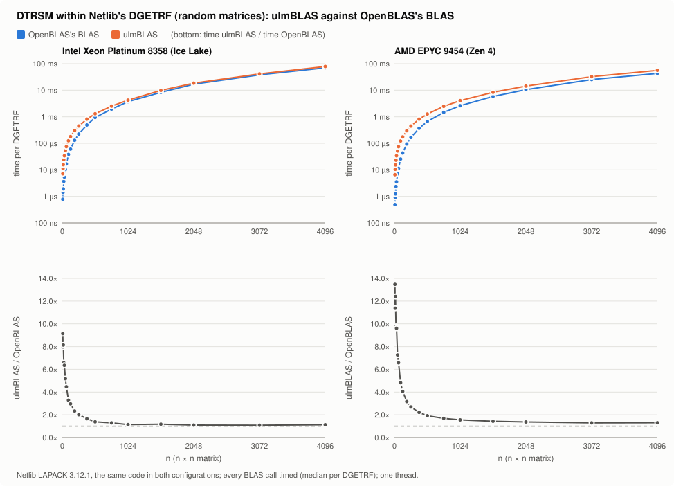

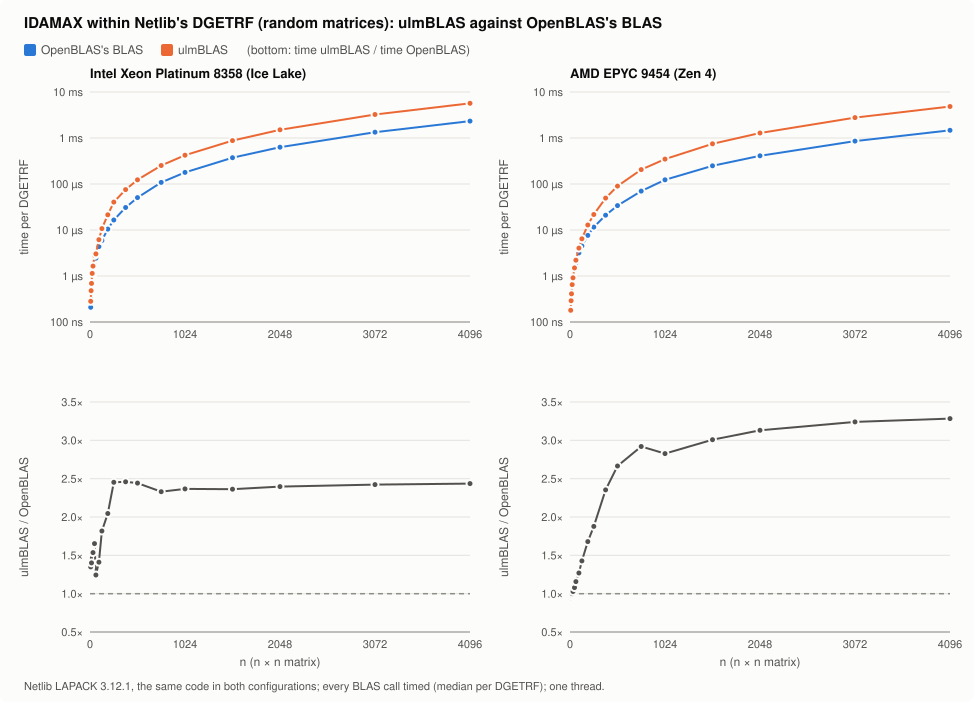

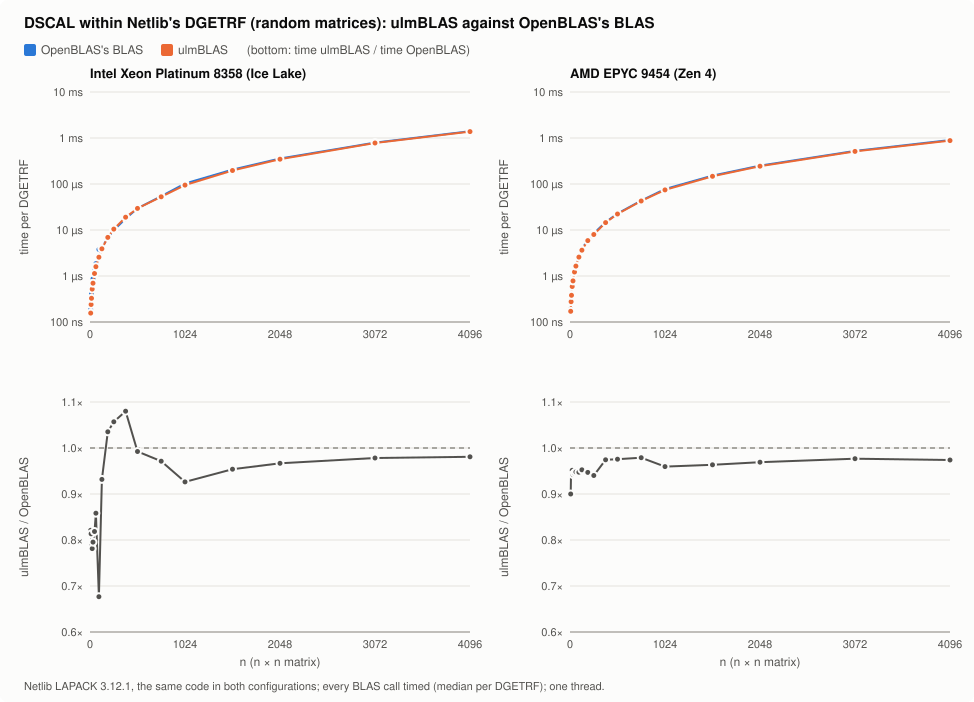

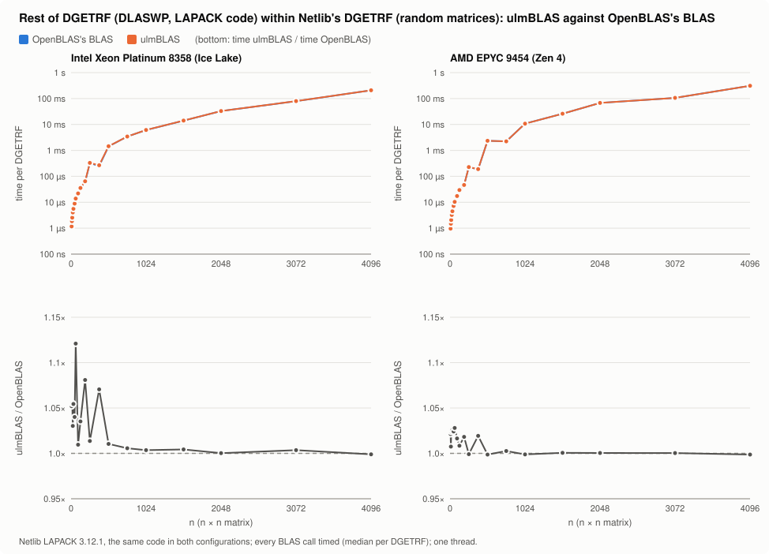

- **Small matrices (n ≤ 128): DTRSM**, then DGEMM.  DTRSM causes 62–82%
  (Ice Lake) and 82–90% (Zen 4) of the time lost, DGEMM most of the rest.
  Per call, a tiny DTRSM of DGETRF2 costs about 0.9 µs more in ulmBLAS
  (n = 8: 7 calls, 0.78 → 7.1 µs on Ice Lake, 0.49 → 6.6 µs on Zen 4),
  a tiny DGEMM about 0.1–0.2 µs more.
- **Large matrices, Ice Lake: DGEMM** (73–78% of the time lost for
  n ≥ 1024; ulmBLAS's DGEMM 7–21% slower), then DTRSM (9–14% slower) and
  IDAMAX.
- **Large matrices, Zen 4: DTRSM and IDAMAX.** ulmBLAS's DGEMM is as fast
  or faster (0.95× at n = 4096), DTRSM 1.3–1.6× slower, so Netlib +
  ulmBLAS is about as fast as Netlib + OpenBLAS's BLAS for n ≥ 2048.
- **IDAMAX** is 2.4–3.3× slower in ulmBLAS for n ≥ 512 on both machines
  (a small part of the time: up to 3% of DGETRF).  **DSCAL** is as
  fast or slightly faster.
- **The rest of DGETRF is the same** in both configurations (the same
  DLASWP and DGETRF/DGETRF2 code of liblapack): 0.99–1.05×.  For random
  matrices it is mostly DLASWP: 208 ms (Ice Lake) and 310 ms (Zen 4) of
  DGETRF at n = 4096, against about 1 ms for column-dominant matrices.

## ulmBLAS with OpenBLAS's DTRSM

What if ulmBLAS had OpenBLAS's DTRSM?  `netlib_ulmblas_obtrsm` (`common.jl`)
is Netlib LAPACK + ulmBLAS with one change: after `UlmBLAS.forward()` the
LBT entry of `dtrsm_64_` is set to OpenBLAS's `dtrsm_64_`
(`BLAS.lbt_set_forward`).  DGEMM, IDAMAX and DSCAL stay with ulmBLAS
(`bench.jl` prints the target of each routine, `results/*-trsm.bench.txt`).
Benchmark of the complete DGETRF as before (`bench.jl`, same sizes and
matrices, random and column-dominant taking turns), with
`CONFIGS=netlib_ulmblas,netlib_ulmblas_obtrsm,netlib_openblas`; `test.jl`
(948 checks) and `coldom.jl` (231 checks) pass for all three
configurations.  Jobs 8244656 (Ice Lake, uc2n601) and 8244657 (Zen 4,
uc3n070), `cluster/job-trsm.sh`, `results/*-trsm.*`.

Speedup over Netlib LAPACK + OpenBLAS's BLAS (time of Netlib + OpenBLAS's
BLAS / time), random matrices:

| n | Ice Lake: ulmBLAS | ulmBLAS + OpenBLAS's DTRSM | Zen 4: ulmBLAS | ulmBLAS + OpenBLAS's DTRSM |
|---:|---:|---:|---:|---:|
| 8 | 0.14× | 0.50× | 0.10× | 0.50× |
| 32 | 0.20× | 0.55× | 0.15× | 0.60× |
| 128 | 0.36× | 0.60× | 0.33× | 0.73× |
| 256 | 0.63× | 0.78× | 0.60× | 0.86× |
| 512 | 0.79× | 0.85× | 0.84× | 0.95× |
| 1024 | 0.88× | 0.90× | 0.92× | 0.97× |
| 2048 | 0.93× | 0.93× | 0.98× | 1.00× |
| 4096 | 0.95× | 0.95× | 1.02× | 1.03× |

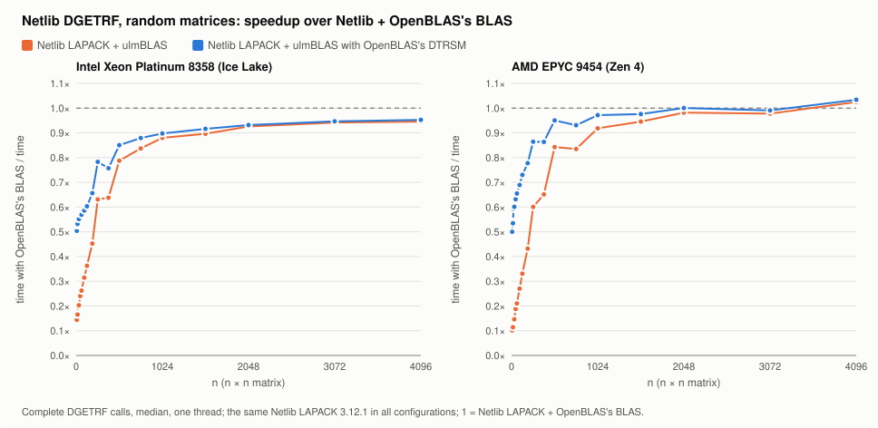

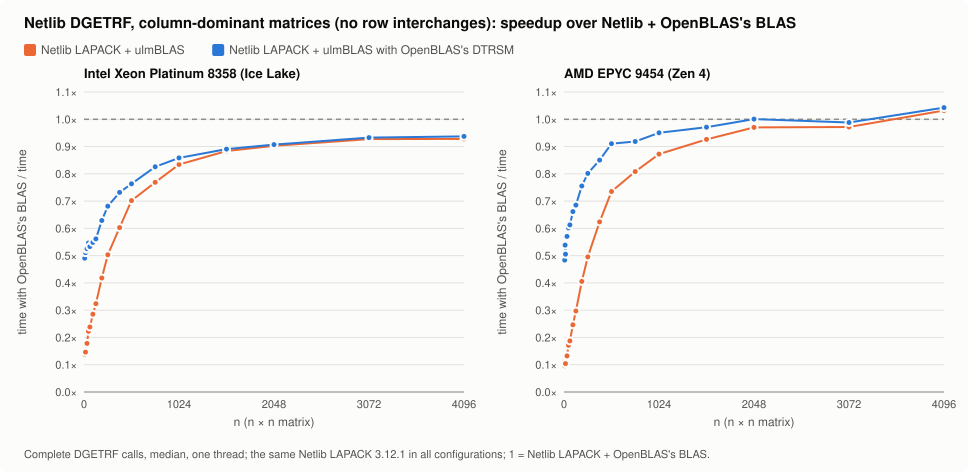

Time of DGETRF (top, log scale) and time / time with OpenBLAS's BLAS
(bottom; above 1 = slower than with OpenBLAS's BLAS):

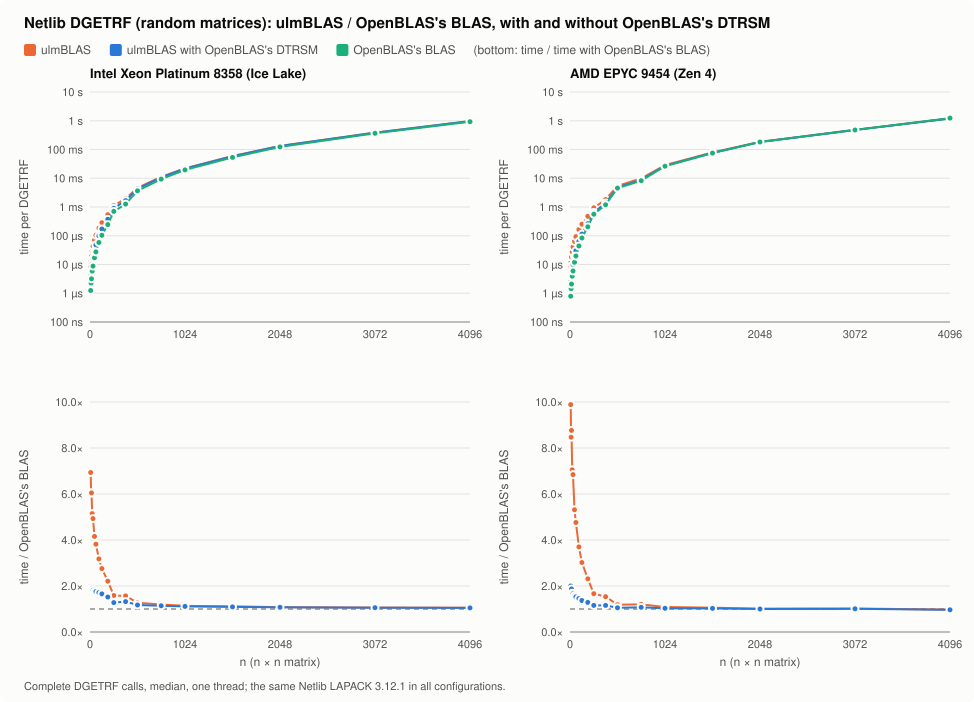

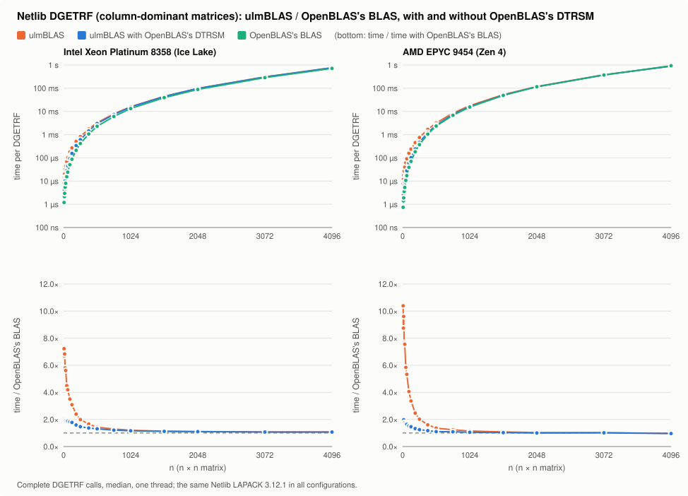

- **Small matrices:** OpenBLAS's DTRSM removes more than half of the gap
  (n = 8: 0.14× → 0.50× on Ice Lake, 0.10× → 0.50× on Zen 4; n = 128:
  0.36× → 0.60× and 0.33× → 0.73×).  The rest, a factor of about 2 for
  n ≤ 64, is in the other tiny BLAS calls, mostly DGEMM (see the time per
  routine).
- **Large matrices:** on Zen 4, with OpenBLAS's DTRSM Netlib + ulmBLAS
  reaches Netlib + OpenBLAS's BLAS for n ≥ 1024 (0.97–1.03×); on Ice Lake
  it changes little for n ≥ 1024 (0.88 → 0.90× at 1024, 0.95× at 4096
  either way): there the gap is ulmBLAS's DGEMM.
- Column-dominant matrices: the same picture (DLASWP is the same code in
  all three configurations).

### Against Julia's default

The same benchmark with all four configurations in one run
(`CONFIGS=openblas,netlib_ulmblas,netlib_ulmblas_obtrsm,netlib_openblas`,
`cluster/job-trsm.sh R JULIA CONFIGS`); `test.jl` (948 checks) and
`coldom.jl` (308 checks) pass, pivots equal to OpenBLAS's in every run.
Jobs 8245019 (Ice Lake, uc2n601) and 8245020 (Zen 4, uc3n069),
`results/*-trsm4.*`.  Speedup over Julia's default (time of OpenBLAS's
DGETRF / time):

| n | Ice Lake: ulmBLAS | ulmBLAS + OpenBLAS's DTRSM | OpenBLAS's BLAS | Zen 4: ulmBLAS | ulmBLAS + OpenBLAS's DTRSM | OpenBLAS's BLAS |
|---:|---:|---:|---:|---:|---:|---:|
| random | | | | | | |
| 8 | 0.05× | 0.18× | 0.36× | 0.04× | 0.21× | 0.42× |
| 32 | 0.13× | 0.35× | 0.61× | 0.09× | 0.40× | 0.66× |
| 128 | 0.31× | 0.52× | 0.85× | 0.29× | 0.65× | 0.90× |
| 256 | 0.43× | 0.53× | 0.68× | 0.43× | 0.63× | 0.73× |
| 512 | 0.65× | 0.71× | 0.83× | 0.47× | 0.53× | 0.56× |
| 1024 | 0.85× | 0.87× | 0.97× | 0.60× | 0.63× | 0.65× |
| 2048 | 0.85× | 0.86× | 0.92× | 0.65× | 0.67× | 0.67× |
| 4096 | 0.73× | 0.74× | 0.77× | 0.75× | 0.76× | 0.73× |
| column-dominant | | | | | | |
| 8 | 0.05× | 0.17× | 0.34× | 0.04× | 0.19× | 0.38× |
| 32 | 0.12× | 0.33× | 0.62× | 0.08× | 0.37× | 0.64× |
| 128 | 0.31× | 0.53× | 0.94× | 0.29× | 0.67× | 0.98× |
| 256 | 0.55× | 0.74× | 1.09× | 0.51× | 0.82× | 1.03× |
| 512 | 0.89× | 0.99× | 1.27× | 0.77× | 0.95× | 1.06× |
| 1024 | 1.15× | 1.18× | 1.38× | 0.93× | 1.01× | 1.07× |
| 2048 | 1.08× | 1.08× | 1.20× | 0.98× | 1.01× | 1.01× |
| 4096 | 0.88× | 0.89× | 0.94× | 0.96× | 0.97× | 0.93× |

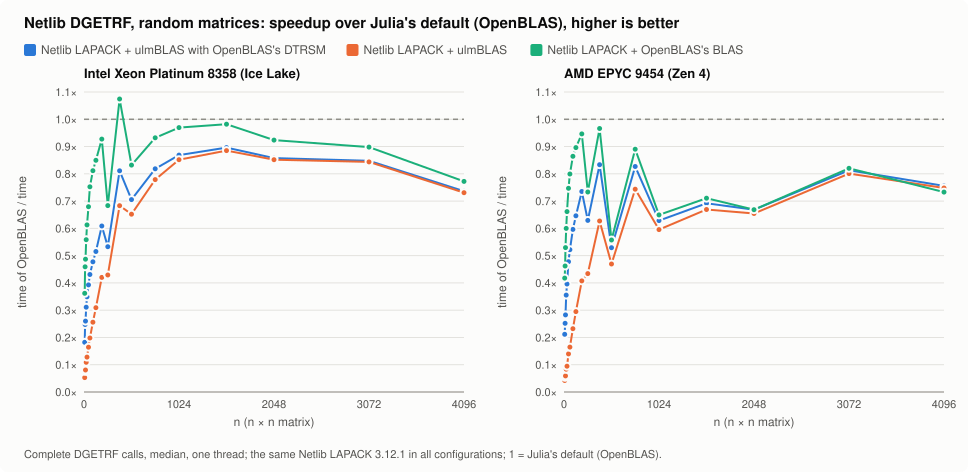

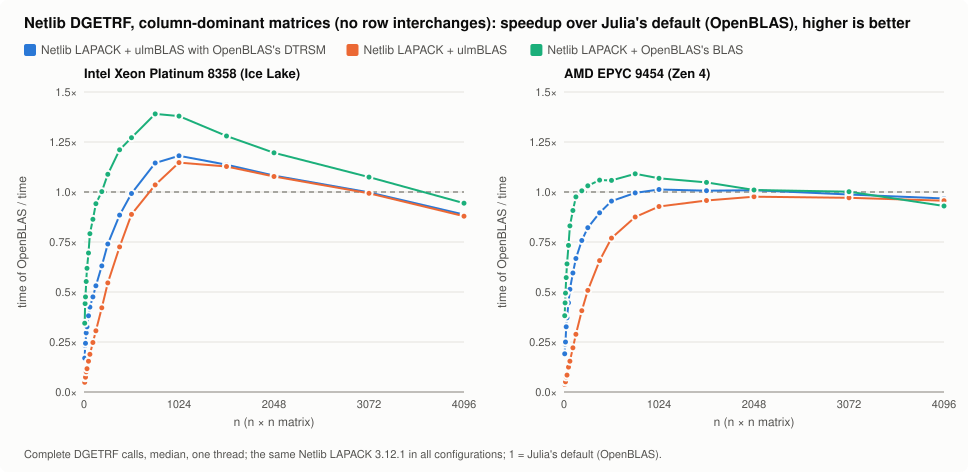


- **Small matrices:** with OpenBLAS's DTRSM, Netlib + ulmBLAS reaches
  0.18–0.21× of Julia's default at n = 8 (0.04–0.05× without) and
  0.52–0.65× at n = 128 (0.29–0.31×).  Netlib + OpenBLAS's BLAS itself
  reaches only 0.36–0.42× at n = 8: a factor of about 2 remains in
  ulmBLAS's other small calls, a factor of 2.4–2.8 is Netlib's DGETRF
  itself.
- **Large random matrices:** ulmBLAS with OpenBLAS's DTRSM is 0.71–0.90×
  on Ice Lake and 0.53–0.83× on Zen 4 (n ≥ 512).  On Zen 4 that is
  Netlib + OpenBLAS's BLAS (0.93–1.04× of it), on Ice Lake 4–14% below
  it (DGEMM).  The rest of the gap is Netlib's DGETRF, as with OpenBLAS's
  BLAS; without row interchanges it closes (next point).
- **Column-dominant matrices (no interchanges):** ulmBLAS with OpenBLAS's
  DTRSM is faster than Julia's default on Ice Lake for n = 768–2048
  (1.08–1.18×) and equal on Zen 4 for n = 768–3072 (0.99–1.01×; without
  OpenBLAS's DTRSM 0.87–0.98×).

## Reproduce

```sh
sh lapack/build.sh lapack/liblapack julia           # Netlib LAPACK for this Julia
julia --project=lapack -e 'using Pkg; Pkg.instantiate()'
julia --project=lapack lapack/verify.jl
julia --project=lapack lapack/test.jl
julia --project=lapack lapack/coldom.jl                 # column-dominant matrices
CONFIGS=openblas,netlib_ulmblas,netlib_ulmblas_obtrsm,netlib_openblas MATRIX=dense,coldom \
    julia -t1 --project=lapack lapack/bench.jl t.tsv     # with OpenBLAS's DTRSM
julia lapack/plot_trsm.jl OUTDIR "Ice Lake=t.tsv" ...
julia -t1 --project=lapack lapack/profile.jl p.tsv      # time per BLAS routine
julia lapack/plot_profile.jl OUTDIR "Ice Lake=p.tsv" ...                # one figure per routine
julia -t1 --project=lapack lapack/bench.jl results.tsv   # [n ...]
julia lapack/plot.jl OUTDIR "Ice Lake=a.tsv" "Zen 4=b.tsv"
MATRIX=dense,coldom julia -t1 --project=lapack lapack/bench.jl c.tsv
MATRIX=coldom PREFIX=coldom julia lapack/plot.jl OUTDIR "Ice Lake=c.tsv" ...
```

On bwUniCluster: `cluster/prepare.sh R JULIA` on a login node (depot and
LAPACK tarball, R/src = these sources), then
`sbatch -p dev_cpu_il cluster/job.sh R JULIA` (build, verify, bindings,
tests, benchmark on one exclusive node); `cluster/job-coldom.sh` for the
column-dominant matrices, `cluster/job-profile.sh` for the time per BLAS
routine, `cluster/job-trsm.sh` for ulmBLAS with OpenBLAS's DTRSM.

## Limitations

- An experiment: not wired into the package.  The configuration is global
  to the process (LBT), as for `UlmBLAS.forward()`.
- liblapack must be built against the LBT of the Julia it runs in
  (libblastrampoline 5).  It uses the libgfortran of the compiler it was
  built with (on Linux the soname matches Julia's copy; on macOS
  Homebrew's libgfortran is loaded next to Julia's).
- The algorithms differ: Netlib's `DGETRF` is blocked (NB = 64 from
  `ILAENV`) with the recursive `DGETRF2` for the panels; OpenBLAS has its
  own LU.  `netlib_openblas` separates the two effects.
- Single-threaded only.  The ulmBLAS libraries are those of the package's
  artifact (ulmBLAS 6c554eec), not yet those of ulmBLAS_jll 0.2.
